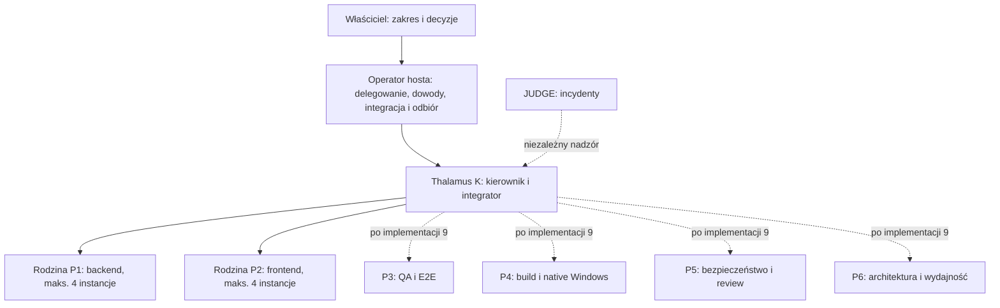
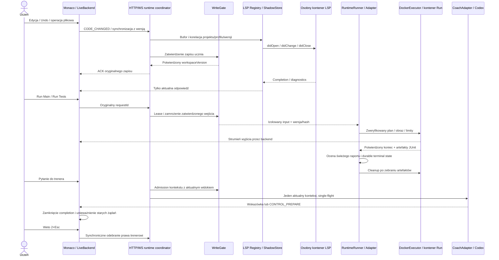

# PairCoach — STATUS kampanii 1–9 i przekazanie do code review

Stan zamrożony po poleceniu właściciela STOP, 12 listopada 2026. To jest **checkpoint nieukończonej implementacji**, a nie odebrane wydanie Polyglot. Nowym, wykonywanym poleceniem jest zachowanie całości pracy, commit, push i ten raport; wcześniejsza realizacja została zatrzymana. Nie uruchamiać automatycznie opisanych eksperymentów ani harnessów WIP.

## 1. Werdykt dla reviewera

- Zadania **1–8: implementacje dostarczone i lokalnie przyjęte**, z testami dotyczącymi ich zakresu. Pełny odbiór regresji na jednej końcowej rewizji jest **NOT_RUN**. Nie jest to deklaracja, że wszystkie stare wyniki automatycznie obowiązują dla obecnego drzewa.
- Zadanie **9: NIEUKOŃCZONE**. Powstała rozbudowana implementacja portów, wykonania Docker, koordynacji runtime, integracji frontendowej i usług językowych. Są rzeczywiste próby Docker/LSP oraz testy komponentów. Nie wykonano wymaganej końcowej macierzy LIVE całego produktu na jednej rewizji.
- **Cała kampania:** 2026-11-11 14:52:15 → 2026-11-12 08:11:41 Europe/Warsaw: **17 h 19 min 26 s**. **Samo zadanie 9**, liczone od pierwszego TASK: 2026-11-11 19:24:54 → 08:11:41: **12 h 46 min 47 s**. „17 godzin zadania 9” byłoby nieprecyzyjnym przypisaniem całego czasu ostatniemu zadaniu.
- Role Thalamusa zatrzymano administracyjnie: wszystkie 14 ról projektu `software_dev_2` miało potwierdzone pauzy i brak aktywnych tur. Nie wznowiono implementacji podczas przygotowania publikacji.
- **Nie ma podstaw do procentowej oceny gotowości ani alarmu sukcesu wszystkich dziewięciu zadań.** Commit i push oznaczają zachowanie pracy, nie pozytywny odbiór produktu.

### Identyfikacja publikowanego kodu

Bazą drzewa jest `a8b4b167b503160fadecf44975ae54aea9d85497`, tree `8d9bca4e139342a20cbf23bc3ba6d4406e737eef`: ostatnia spójna kompozycja backendu, frontendu i bibliotek LSP. Dołączono przez bezkonfliktowe merge istniejące dostawy:

| Dostawa | Rewizja | Zakres |
| --- | --- | --- |
| Kod aplikacji / bounded stage reads | `a8b4b167b503160fadecf44975ae54aea9d85497` | Koordynator runtime, FE, Store/Factory i ograniczone odczyty |
| Pakowanie i instrukcja Polyglot | `48c8aea5482f31a3c6ff273436d10a7a7d83564a` | Allowlista, test selection/closure, weryfikator i dokumentacja |
| Przygotowanie / odzyskiwanie obrazów | `902da3ccd8d1133ce692b1bc676e87b3d0bd0652` | Producent, tożsamość obrazów, jawny checkpoint świeżego guardu |
| Oracle granic architektury | `9f251ef62687bfa31a7edbe80593ff308a6d6956` | Już jest w przodkach bazy; nie dodawano go powtórnie |

**Ta konkretna końcowa kompozycja nie była uruchamiana jako wydanie.** Bezkonfliktowe scalenie nie dowodzi kompatybilności wykonawczej. W trakcie publikacji nie poprawiano algorytmów produktu ani nie dopisywano pozytywnych wyników testów.

Przejrzano 159 kopii roboczych PairCoach, zawierających 123 różne HEAD-y. Główna gałąź zachowuje wybraną kompozycję. Dodatkowe gałęzie `checkpoint/20261112/<sha12>` zachowują niezależne końce historii, w tym odrzucone lub eksperymentalne warianty; **nie są rekomendacją ich użycia**. Lista jest w [provenance.json](docs/checkpoint-20261112/provenance.json). Oryginalne SHA z tej listy oraz przodkowie publikacji wystarczają do odtworzenia wszystkich zinwentaryzowanych commitów. `node_modules`, prywatne stany runtime, poświadczenia i obrazy Docker nie są częścią tego zapisu źródeł.

## 2. Organizacja i zakres kampanii

Zadania 1–3 rozpoczęto sekwencyjnie. Następnie właściciel polecił najpierw implementować 4–9 przy pomocy K i rodzin developerów BE/FE, maksymalnie po cztery instancje P1 i P2. Ciężkie QA/E2E, build/wdrożenie, security/review i przegląd architektoniczno-wydajnościowy P3–P6 miały wrócić po zakończeniu implementacji 9. Krótkie testy developerów pozostawały wymagane. Nie wolno było osłabiać istniejących asercji, progów czasowych ani golden fixtures. Operator odpowiadał za niezależny odbiór; K za integrację dostaw Thalamusa.



Diagram opisuje przypisanie odpowiedzialności, nie dowodzi jednoczesnej aktywności wszystkich ról. W chwili STOP wszystkie były spauzowane. Nie należy utożsamiać liczby przygotowanych profili z liczbą efektywnie równoległych developerów.

## 3. Zadania 1–8: zakres i wynik implementacji

| Nr | Co należało naprawić | Co dostarczono | Rewizja integracyjna / przyjęta | Czas do obserwowanego przyjęcia implementacji |
| --- | --- | --- | --- | --- |
| 1 | Błąd strumienia pliku statycznego nie może kończyć backendu | Obsługa asynchronicznych błędów otwarcia/odczytu, przerwanego pobierania i odpowiedzi HEAD; żywotność API/WS | `45b77907fc651696df0dda926e954927561a9948` | 12,77 min |
| 2 | Rosnąca pamięć CommandLedger oraz niejednoznaczne finish/network-loss | Skróty payloadów, ograniczony budżet i lifecycle zachowujący idempotencję; pomijanie PING; rozliczanie finish z oryginalną tożsamością zamiast drugiej operacji | `24484a25e4b19d61f5e5243a9d188585a39d78b7` | 74,54 min |
| 3 | Anulowanie trenera, single-flight i wyścig Run/finish | Zatrzymywanie analiz i zakaz nowych bodźców podczas finish przy zachowaniu faktów Run; testy rollbacku i własności inode | `251c8a52b0f494306b5e53aee42f4a02ad0b7fc0` | 47,00 min |
| 4 | Raport sesji A niedostępny po rozpoczęciu B/restartcie | Autoryzowany odczyt historii w magazynie właściwego projektu oraz prosty dostęp z UI; poprawka przycinania interfejsu wykryta w odbiorze | `85b8d11800e35fc58ec2eb7fff5548f1ac6ab1ca` | 19,91 min |
| 5 | Model nie zna kursora i zaznaczenia | Monaco → transport ograniczony częstotliwością → wersjonowany widok → CoachContext i jawna projekcja Codex; aktualny widok następnego CHAT bez model call na ruch kursora | `25b0f110ec27ebdd6877fcf85eb0103c32c0e881` | 18,86 min |
| 6 | Dymek znika poza edytorem; SafeMarkdown zmienia tekst | Ograniczenia względem kontenera, korekta po resize/splitter, dostępne kontrolki i niezasłanianie aktywnego kodu; naprawa encji i kolejności checkboxów | `c623ae0bd009908b9f91ebbe62548df7bcf2c9a3` | 13,90 min |
| 7 | Niewykonalne propozycje, MUTE i niepoprawne evidenceIds | Runtime capabilities; brak obietnicy nieobsługiwanego GENERATE_TESTS; naturalne MUTE powiązane z aktualnym człowiekiem; cytaty/YAML nie autoryzują; nieznane IDs nadal jawnie odrzucane | `b084c0b8dd6df669253778f08e0f975ab3d03068` | 22,92 min |
| 8 | Sprzeczne instrukcje Codex/Gemini i pozorne potwierdzenie Revision | Spójny Codex trener+raport, `gpt-6.1-sol`/`medium`, `codex exec --ephemeral` z logowaniem ChatGPT; weryfikacja rzeczywistych źródeł/manifestu, przenośny wybór testów i commandClosure | `38d5130634d0f0ac7ace4c82a77273fe7f4ef3e9` | 37,61 min |

Te czasy obejmują kolejki, odczyt dowodów i poprawki, a nie wyłącznie programowanie. Etapy częściowo zachodziły na siebie, więc nie należy sumować ich jako rozłącznego czasu pracy. W etapie 7 odrzucono pierwszą wersję uprawniającą do MUTE cytowane dane; poprawka trwała około 6,36 min. W etapie 8 było około 10,48 min reworku. Historyczny PASS jednostkowy nie jest finalnym PASS całej aplikacji ani dowodem native Windows.

Istotne ograniczenia: brak finalnej kampanii na jednym SHA; testy NTFS i całościowy Windows pozostawały do odbioru. Przy zadaniu 4 były również błędy przygotowania środowiska przeglądarki (loader JSON/tsx, brak biblioteki Chromium), które nie były błędami samego produktu. Późniejszy dowód UI wykazał rzeczywiste przycinanie i doprowadził do oddzielnej poprawki. Nie zamieniono wcześniejszych nieudanych prób w PASS.

## 4. Zadanie 9 — oczekiwany wynik i wybrany kierunek

### 4.1. Cel użytkownika, którego jeszcze nie odebrano

Jeden istniejący edytor PairCoach miał obsługiwać JS, TS, Python 3.13, Pure Java/Maven na JDK 11/17/21/27 oraz Spring Boot na JDK 21/27. Wybór środowiska miał być w `paircoach.runtime.json`, ze zmianą przez restart. Run/Test i Java/Python LSP miały korzystać z kontenerów Docker, bez instalowania toolchainów zadania na hoście. Użytkownik miał dostać rzeczywiste completion, diagnostykę, wyniki uruchomień/testów oraz skuteczny Stop, bez regresji WriteGate, Undo, Monaco i weta 2×Esc.

Pełna specyfikacja i nadrzędny aneks są zachowane na końcu tego pliku. Nie zastępuje ich tabela podsumowująca. Poniższy opis oddziela projekt, kod i wykonawcze dowody.

### 4.2. Środowisko rzeczywiście rozpoznane

Operator działał w Ubuntu/WSL2. CLI WSL i CLI Windows miały dostęp do tego samego istniejącego Docker Desktop Linux Engine; zapis rekonesansu wskazuje Docker Desktop 4.87.0 / Engine 29.7.2, hostowy Node WSL 22.22.2 i Windows 25.6.1. To **dwie drogi do tego samego linuksowego daemona**, a nie dowód wykonania wszystkich funkcji aplikacji natywnie w Windows.

Rekonesans obejmował 217 zahashowanych lokalnych plików referencyjnych oraz cztery oczyszczone wyciągi. Badano obrazy, cache, ścieżki, porty i Stop. Nie uruchamiano usług obcych projektów ani nie kopiowano ich sekretów. Wzorce wymagały ograniczenia mountów i uprawnień. Podstawowe wyniki i zakres zgody A–B są zachowane w `docs/checkpoint-20261112/evidence/`.

Ważne rozróżnienie dostępu: **host operatora miał Docker**, natomiast sandbox konkretnej roli nie zawsze miał widoczną docelową ścieżkę CLI lub socket. Brak `/usr/bin/docker` w jednej próbie nie oznaczał awarii całego Docker Desktop. Wymagał prawidłowej drogi hostowej, nie cichego użycia lokalnego JDK/Pythona.

### 4.3. Decyzje architektoniczne

1. **Ports & Adapters, zachowanie istniejącego rdzenia.** Neutralny `RuntimeRunner` koordynuje lifecycle przez `ExecutionPort`; `DockerExecutor` realizuje wykonanie. `TaskRuntimeAdapter` wybiera plan i interpretuje wynik. Java/Maven ma parametryzowane profile, a Spring Boot jest wariantem uruchomienia Java, nie nowym językiem w GUI.
2. **RuntimeProfile i TaskRunConfig są osobne.** Profil wybiera adapter/obraz/LSP; zadanie wybiera wejście i tryb Main/Test. Żaden runtime nie powinien rozpoznawać projektu po nazwie katalogu. Hierarchia konfiguracji i względne ścieżki są częścią kontraktu.
3. **Fail-closed wykonania, dostępny edytor.** Niegotowy Docker/obraz blokuje Run/Test z błędem; nie powinien odbierać możliwości edycji i odzyskania draftu. Nie ma dozwolonego niejawnego fallbacku na narzędzia hosta.
4. **Trzy różne stany dokumentu.** Bufor Monaco może być nowszy od ACK. LSP pracuje na własnym projekcie i synchronizowanych buforach; Run tylko na zamrożonej, zatwierdzonej kopii WriteGate. Nie wolno utożsamiać tych stanów ani pozwalać LSP zapisywać źródeł ucznia.
5. **Osobne kontenery i lifecycle Run/LSP.** Stop programu dotyczy konkretnego uruchomienia. Najpierw potwierdzenie końca, potem logi/JUnit i utrwalenie terminalnego wyniku, dopiero potem usunięcie kontenera. Brak potwierdzenia to stan niepewny, a nie sukces.
6. **Prawdziwe wyniki i tożsamości.** Obraz, source input, workspaceVersion, requestId i runId muszą być skorelowane. Zielony exit bez świeżego wykonanego testu nie daje PASSED. Oryginalna mutacja nie może zamienić się w nową po utracie HTTP/WS.
7. **Kontrolowane LSP.** Java/Python w kontenerach; JS/TS może użyć workerów edytora. Tylko completion/diagnostics, brak `workspace/applyEdit`, command i edycji wieloplikowych. CONTROL_PREPARE ma zamknąć widget i unieważnić odpowiedzi przed przejęciem przez trenera.
8. **Ograniczone wykonywanie, nie obietnica pełnego sandboxa.** Non-root, limity RAM/CPU/PIDs, no-new-privileges, ograniczenie capabilities/logów, brak docker.sock i prywatnych hostowych katalogów w kontenerach zadań. Żadne arbitralne flagi od modelu lub zadania.

Są to decyzje wymagające wykonawczej weryfikacji. Sam opis lub istnienie klas nie dowodzi, że każdy wymieniony niezmiennik jest spełniony w finalnej kompozycji.

### 4.4. Mapa faktycznej implementacji

| Obszar | Główne moduły w repozytorium | Dostarczona odpowiedzialność / granica dowodu |
| --- | --- | --- |
| Wspólne DTO | `src/shared/runtime-v2.ts`, `validation-v2.ts` | Kontrakty runtime, Run i walidacja pomiędzy FE/BE |
| Wykonanie | `src/server/execution/`, `src/server/runtime-adapters/` | ExecutionPort, DockerExecutor, immutable input, journal, plan policy, rodziny adapterów i interpretacja JUnit |
| Integracja aplikacji | `src/server/runtime-coordinator/` | Startup, Workspace/Project/Execution, RuntimeRunner, Settings, WriteGate authority, wersje, oryginalne mutacje, ownership klienta, maintenance, sieć i źródło LSP |
| LSP | `src/server/language/` | Registry, runtime binding, ACK ledger, selected-cache authority, Factory, ShadowStore, process journal, boot publisher, JSON-RPC, sesja serwera i konfiguracja providera |
| Monaco / klient | `src/components/EditorPanel.tsx`, klient i bridge usług językowych | V2 transport, stan usług, explicit prepare, synchronizacja i korelacja; pełny końcowy LIVE nie został wykonany |
| Dane środowisk | `paircoach.runtime.json`, `runtimes/`, `docker/`, `examples/` | Profile i locki, definicje obrazów, projekty przykładowe; istnienie pliku nie dowodzi działania przykładu |
| Obsługa operatora | `scripts/runtime-prepare*.mjs`, `runtime-operator*.mjs`, `runtime-image-retention.mjs` | Przygotowanie, identyfikacja i zachowanie obrazów oraz jawne odzyskiwanie |
| Pakowanie | `scripts/package-windows.mjs`, `verify-source-revision.mjs`, `docs/windows-polyglot.md` | Rozszerzona allowlista/closure, wybór testów, instrukcje; finalny świeży ZIP z pełnym LIVE: NOT_RUN |

Przed wyciąganiem wniosków reviewer powinien sprawdzić **call-site w aktualnym HTTP/WS**, nie tylko testować samą klasę. W kampanii istniał długi okres, gdy aktualne biblioteki były przyjęte, lecz centralna gałąź K pozostawała na `88d40b2` z integracją bibliotek. Pełna kompozycja backendu/FE była w innym checkoutcie. W publikacji bazą jest dopiero `a8b4b167`, zawierające tę kompozycję.

### 4.5. Rzeczywisty przepływ, który implementacja próbuje zapewnić

Diagram jest mapą kontraktu do code review. Nie przedstawia zakończonego testu E2E.



### 4.6. Co faktycznie sprawdzono

**A–B:** wykonano rzeczywiste małe uruchomienia JDK 21/27 i Python 3.13, sprawdzano wersję/release, zatrzymanie właściwego kontenera oraz nienaruszenie kontenera kontrolnego. Są próby przez WSL i natywne wywołanie Windows. Są też rzeczywiste completion Java 27 i Python, zmiana nazwy metody oraz próby diagnostyki. **Nie jest to aplikacyjny GUI LIVE**. Operator dopuścił C–E z otwartym, jawnie zapisanym błędem diagnostyki JDK 21. Decyzja `STAGE09-AB-ROOT-DECISION.json` wyraźnie ogranicza zgodę do implementacji.

**Kod backendu i klienta:** dostarczono integrację neutralnego runnera, runtime startup/settings/Run, trwałych oryginalnych mutacji, reconcile i niepewnego Stop. Naprawiono błąd, przez który rozliczona pusta historia mutacji blokowała nowego klienta (`e3965caf75f0e2900dd498667092b670fb314421`). Dostarczono faktyczne wywołanie admission kontekstu Coach, a nie wyłącznie sam interfejs biblioteki (`6d098bf22e0f1d4cd21043b4abed068146600e0c`). Pełny końcowy scenariusz użytkownika pozostaje NOT_RUN.

**Końcowy komponent a8:** surowe wyniki obejmują **63/63 PASS**, bez skipped/cancelled. Użyto rzeczywistych plików natywnych, Workerów oraz Registry/Selected/Factory/Store, ale kontrolowanych odpowiedników OCI, lease i transportu procesu. ROOT sprawdził 72 hashe artefaktów oraz zgodność 532 blobów źródłowych. Nie uruchamiał tego testu ponownie. Jest to dowód komponentowy, **nie actual Gate/backend/Docker/LSP/Windows, nie 30-sekundowe READY i nie pełny produkt**.

**Przygotowanie obrazów:** udało się zachować rzeczywiste tożsamości i wyniki przygotowania. Jedna ścieżka recovery/prepare zajęła 763,544377 s. Potwierdzenie istniejącego obrazu i jego probe nie potwierdza offline Run, działania GUI ani LSP tej samej instalacji.

### 4.7. Najważniejsze błędy i nieudane hipotezy

| Problem | Konkretny dowód / pomiar | Znaczenie i stan na STOP |
| --- | --- | --- |
| Java 21 / przypięty JDT/ECJ | Pełna eksperymentalna próba 5a: FAIL, 132,401 s; Java 27 w tym zakresie PASS; Python osobno PASS 12,035 s | Pinned compiler potrafi zgłaszać warning 4195412 dla starszego poziomu 21 wobec najnowszego 27 mimo wyłączonego preview. Oczekiwanej semantyki oryginalnego oracle nie udowodniono. Nie wolno zmienić severity lub testu tylko dla zielonego wyniku |
| Import LSP w rzeczywistej ścieżce | `0aaa21d8`: FAIL 124,296752 s, 0 client RPC; `e3f96cb7`: FAIL 60,240321 s, 0 client RPC, 1 unsolicited server frame | Pierwszy przebieg zatrzymały granice zbierania journalu; następny nie osiągnął initialized przed readiness 30 s. Nie był to pozytywny test semantic completion |
| Koszt pełnych skanów i I/O | 1847 plików zależności, 56 727 070 B; para bazowa 92,642 s, para po async 98,431 s | Hipoteza, że samo przeniesienie odczytów poza event loop wystarczy do skrócenia całej ścieżki, nie potwierdziła się. To nie kontrolowany globalny benchmark wszystkich patchy |
| Zbędne fizyczne przepisywanie zależności | Refresh Store na `29990e2f`: 35,2716558 s; ponownie zapisano wszystkie 1847 niezmienionych plików, 1853 file fsync i 1853 directory fsync | Uzasadniło delta-write, a nie usuwanie kontroli świeżości. Pojedynczy instrumentowany pomiar z narzutem, nie SLA |
| Niebezpieczny skrót optymalizacji | Odrzucony wariant `a43a6c9d`: natywna podmiana ancestor przez rename/symlink/restore | Cache kanonizacji prefiksu osłabiał własność sprawdzanej ścieżki. Został zachowany do review, nie przyjęty do rozwiązania |
| Nadmiar alokacji journalu | Odczyt alokował stały bufor 64 MiB na plik; przy około 1852 plikach suma żądanych alokacji ~115 GiB | To suma alokacji, **nie dowód 115 GiB jednoczesnego RSS ani Windows CUA leak**. Poprawiano rozmiar odczytów, zachowując bariery natywne |
| Guard i przygotowanie obrazów | Przebieg `82eed10f`: FAIL 60,331 s; preflight 65,522 s przekraczał TTL 60 s | Wprowadzono jawny świeży checkpoint przed efektem (`902da3cc`), bez cichego wydłużania limitu lub obchodzenia guardu |
| Tożsamość obrazów / klient Docker | Różne pola OCI Config ID vs manifest digest, wersja `.0` vs `.0.2`, kolejność kluczy JSON, prywatna konfiguracja Docker Desktop | Powodowały rzeczywiste zatrzymania przygotowania i wymagały korekt normalizacji/provenance; nie były dowodem, że Run przeszedł |
| Próba końcowego host measurement | Sandbox roli nie widział działającej ścieżki CLI/socketu; ENOENT przed pomiarem | Harness hostowy pozostał WIP bez freeze/admission. **Nie został uruchomiony**. Nie ma nowego wyniku czasu dla a8 |

Starsze nieudane próby loadera Node/tsx, TMPDIR i test-fixture również zostały zachowane. Błąd infrastruktury testowej nie jest automatycznie błędem produktu; jednocześnie wynik uzyskany dopiero po jego poprawie ma własną rewizję i zakres. Nie wolno sumować wszystkich historycznych PASS jako odbioru aktualnej kompozycji.

### 4.8. Jak optymalizowano i co zostało z tej pracy

Najpierw oddzielano odczyty od event loop oraz serializowano admission. Następnie pomiary ujawniły koszt powtarzanego zapisu niezmienionych zależności. `LanguageShadowDeltaPlan` wylicza plan po ścieżce/hash/rozmiarze i katalogach. `LanguageShadowStore` zachowuje fizycznie niezmienione pliki zależności, zapisuje delty i wymagane katalogi/manifesty, pozostawiając pełne kontrole świeżości i tożsamości.

`LanguageBoundedRead.ts` i Worker ograniczają równoległość do 1–4 workerów, kolejkę i żądania odczytu (do 256 MiB plus narzut), przekazują bufory, sprawdzają natywne readRegular i wymagają drain/close także po błędzie. Sama próba odczytu 1847 plików dała około **1,406 s helpera / 1,801687 s całego procesu**, zgodne hashe i zakończenie workerów. **To nie jest czas całego prepare, importu, gotowości LSP ani GUI.**

Końcowe `a8b4b167` podłącza ograniczony odczyt źródeł i zależności we wspólnym FIFO zarówno przy CREATE, jak i ordinary REFRESH. Refresh używa lokalnego jednorazowego tokenu ukończonego odczytu, następnie delta-write. Nie przyjęto ogólnego boola „current” zastępującego ponowną kontrolę ani fallbacku z niedokończonego tokenu. Ten zakres został odczytany i lokalnie przetestowany, ale **pełna wydajność a8 pozostaje UNMEASURED**.

Niedokończony eksperyment preview-policy jest w `tests/language-provider-preview-policy/` i `investigations/stage09/provider-preview-policy/`. Nie ma odpowiadającej zmiany produkcyjnego `LanguageProviderConfiguration`. Ustalenie z kodu przypiętego JDT: `java.settings.url` może ładować ustawienia kompilatora, natomiast sama deklaracja `profile.analysis.preview` nie była konsumowana przez builder/hash. Wcześniejsze uruchomienie już wyłączało preview, więc dopisanie kolejnej flagi nie stanowiło wykazanej naprawy. Nie należy przyjmować eksperymentu jako gotowego rozwiązania.

### 4.9. Czego konkretnie brakuje do dowiezienia zadania 9

1. Udowodnionej gotowości rzeczywistej, zintegrowanej ścieżki usług językowych, z aktualną kopią źródeł i otwartym ustaleniem Java 21; finalny pomiar a8 nie istnieje.
2. Całej macierzy TEST-101..107 przez GUI: edycja → ACK → Run/Main/Test w kontenerze → rzeczywisty wynik odpowiadający zmianie; negatywne i pozytywne próby, diagnostyka i jej wyczyszczenie.
3. Java 11/17/21/27 z potwierdzeniem efektywnego poziomu języka, nie tylko `java --version`; Spring 21/27 z HTTP i Stop oraz Python 3.13 z prawdziwym pytest/JUnit.
4. Zmiany nazwy metody i aktualnej completion Java/Python; udowodnienia odrzucania starych odpowiedzi, pełnej synchronizacji po Undo/snapshot/COACH/file operations i wyścigu completion/CONTROL_PREPARE/Enter.
5. Pełnego przełączenia profili przez restart bez przenoszenia kontekstu, cache i ownership.
6. LIVE Stop/timeout/restart cleanup z nietkniętym kontenerem kontrolnym; niepewny Stop musi zachować ten sam runId. Dla Spring healthcheck nie może kończyć RUNNING.
7. Uczciwych negatywnych wyników JUnit: stary plik, wszystkie skipped, brak testów, niezerowy exit przy zielonym XML; świeżość i input/runId muszą być dowiedzione.
8. Braku modyfikacji źródeł ucznia przez kontener, braku zależności od hostowego toolchainu, działania przygotowanego cache z `--pull=never` i błędów środowiska bez utraty draftu.
9. Rzeczywistego skonfigurowanego AI coach dla Java i Python oraz braku regresji weta/Undo/autosave.
10. Przejścia scenariusza ze świeżo rozpakowanej paczki na docelowej topologii oraz niezależnego końcowego QA/review P3–P6 na tym samym SHA i locku obrazów.

W [final-acceptance-matrix.json](docs/checkpoint-20261112/final-acceptance-matrix.json) jest **37 pozycji finalnego odbioru, wszystkie NOT_RUN**. To lista brakujących dowodów końcowej wersji, **nie stwierdzenie, że przez całą kampanię nie wykonano żadnego testu**. Obejmuje również regresje 1–8, odczyt historycznych dowodów, REQ-101 i wymagania aneksu.

## 5. Dlaczego nie dowieziono po 17 godzinach — analiza przyczyn

### 5.1. Przyczyny techniczne, które mają dowody

Rozszerzenie 9 było większe niż pojedyncza poprawka: obejmowało siedem profili runtime, cztery wersje JDK, Spring na dwóch JDK, dwa kontenerowe LSP, obrazy/cache, trwały lifecycle wykonania, Monaco i realne E2E. Główna ścieżka wymagała wielu powiązanych zmian; sama liczba agentów nie usuwa zależności między Store, Factory, admission, ACK i aktualnym źródłem.

Najbardziej kosztownym ujawnionym problemem była gotowość LSP: prywatne kopie, pełne ponowne sprawdzanie plików, journal, fsync i zależności. Początkowa hipoteza async nie skróciła całego przebiegu; dopiero późniejszy pomiar wykazał zbędne przepisywanie ponad 56 MB na refresh. Równolegle otwarte pozostawało zachowanie przypiętego JDT dla Java 21. Infrastruktura przygotowania obrazów dodawała błędy wersji/tożsamości/guardu i kosztowne rzeczywiste próby.

Doszedł rzeczywisty problem operacyjny Thalamusa: zapytanie Watchdoga utrzymywało monitor ProjectStore i pośrednio SessionRuntime, blokując reakcję na wejście. Zarejestrowano opóźnienie przyjęcia wiadomości **121,523 s** i timeouty HTTP 45 s. Ten problem naprawiono oddzielnie; nie dowodzi to naprawy wszystkich ewentualnych przyczyn przestojów.

### 5.2. Błędy procesu i odpowiedzialność operatora

**Operator nie zapewnił wystarczająco krótkiej drogi od dostawy do jednego działającego pionowego przebiegu.** Dopuszczono zbyt wiele drobnych checkpointów, odrębnych readbacków, kontrprzykładów i kolejnych dokumentów. Część była konieczna do wykrycia rzeczywistych błędów, lecz ich łączny koszt i synchronizacja nie były właściwie ograniczone.

K i ROOT stały się centralnymi bramkami dla odbioru oraz integracji. W krytycznym obszarze Store/Factory istniał pojedynczy właściciel, więc zwiększenie liczby developerów BE/FE nie skracało krytycznej ścieżki. Równoległe prace produkowały komponenty i testy szybciej niż dało się je skomponować i potwierdzić. Duża liczba checkoutów i SHA utrudniała prostą odpowiedź, która kompozycja jest bieżąca.

Najbardziej widoczny skutek: centralna gałąź K przez pewien czas miała przyjęte biblioteki (`88d40b2`), podczas gdy pełny backend i frontend istniały w innym checkoutcie. Komponentowe PASS-y rosły, lecz nie zamykały scenariusza użytkownika. **To był problem koordynacji i integracji, nie brak pracy agentów.**

Właściciel polecił odłożyć ciężkie audyty na koniec. Nie należy obarczać tej decyzji winą za 17 godzin: nadal wykonywano krótkie testy developerów i rozbudowane odczyty K/ROOT. Nie było pełnego zestawu 940 testów wstrzymującego tę kampanię. Operator powinien był wcześniej ograniczyć administrację i zintegrować mniejszy działający przebieg, a resztę rozwijać na tym samym podłożu. Wcześniejsze komunikaty o postępie komponentów nie pokazywały dostatecznie jasno odległości od LIVE produktu.

### 5.3. Czego nie można uczciwie policzyć

Nie istnieje kompletny, rozłączny podział 17 godzin na kodowanie, oczekiwanie, I/O, model, integrację i administrację. Procesy nakładały się na siebie; część pomiarów jest zagnieżdżona. Nie przypisuję zatem procentów przyczyn ani sumuję czasów testów jako pełnego wall clock.

Baza Thalamusa w przedziale całej kampanii do potwierdzonego STOP zawiera **10 381 rekordów SETTLED i 3 UNKNOWN** w `calls`. To zapis księgowania platformy. Nie jest sam w sobie niezależnym dowodem liczby fizycznych wywołań providera, ukończonych odpowiedzi ani rachunku. Szczegóły i tokeny są w [measurement-summary.json](docs/checkpoint-20261112/measurement-summary.json); nie sumować reasoning/cache z innymi polami bez semantyki providera.

**Nie wykazano wzrostu wydajności całej realizacji dzięki mnożeniu P1/P2.** Pierwsze i późniejsze etapy miały inną złożoność; nie ma kontrolowanej próby A/B tego samego zadania. Występują szybkie równoległe dostawy, ale krytyczny integracyjny wynik 9 nie został osiągnięty. Można mierzyć throughput dostaw; nie można z niego wyprowadzić procentu skrócenia ukończonego produktu, którego nie ukończono.

### 5.4. Naprawa Watchdoga — oddzielna od PairCoach

Zmiana produkcyjna powstała w repozytorium Thalamusa: `WatchdogAndVenetianJudge.scopedCommands()`, commit integracyjny `b235eea413a1df84e4be4cea813a25ac8a5de984`, tree `f16014bb9c93cbc8d3c3e2b3655b50e4be21a4fd`. Zastąpiono kosztowną korelację SQL materializowanym zbiorem, zachowując zakres, porządek i limit; istnieje fallback dla nieprawidłowego JSON. Nie zmieniano SQLite WAL, schematu ani indeksów.

Wykonano 5 skupionych testów natywnych JUnit/SQLite, bez skip/abort, oraz package z pominięciem testów (16,259 s). Porównanie syntetyczne tego zapytania: 261,794 ms → 3,603 ms; **nie jest to procentowy benchmark całego Thalamusa**. Sprawdzono zgodność przetestowanego i spakowanego bytecode, wdrożono przy zachowaniu tożsamości projektów/rol/sesji. Późniejszy pojedynczy odczyt wejścia 79,4 ms nie jest p95 ani dowodem wszystkich scenariuszy.

Dokładny patch i potwierdzenie są zachowane w `docs/checkpoint-20261112/evidence/native-watchdog-focused-check/`. Nie włączono klas Javy Thalamusa do aktywnego backendu TypeScript PairCoach. Aktualne polecenie STOP następnie spauzowało role niezależnie od tej poprawki.

<a id="sqlite-port-adapter"></a>

### 5.5. Zadanie THALAMUS-SQLITE-PORT-01 — wydzielenie SQLite przez port i adapter

**Wymaganie właściciela:** dostęp do SQLite miał zostać wydzielony zgodnie z Ports & Adapters. Niniejszy zapis uzupełnia zakres po raporcie nocnego incydentu. **Status realizacji refaktoryzacji: NOT_STARTED; odbiór: NOT_RUN.** Wdrożony hotfix zapytania nie realizuje tego wymagania architektonicznego. Zadanie dotyczy kodu platformy **Thalamus** w repozytorium `codex_synapse_new`; jest zapisane tutaj jako zależność platformowa kampanii PairCoach. Nie zmienia historycznego wyniku odbioru zadań 1–9. Aktualizacja dokumentu nie wznawia zatrzymanych ról ani implementacji.

#### Raport incydentu będącego uzasadnieniem zadania

- **Objaw:** opóźnienie przyjęcia wiadomości 121,523 s i timeouty HTTP 45 s. Stos wykonania wskazywał kosztowny odczyt Watchdoga trzymający monitor `ProjectStore`, z blokowaniem dostępu przez `SessionRuntime`.
- **Mechanizm:** `WatchdogAndVenetianJudge.scopedCommands()` używał skorelowanego `EXISTS` nad `events` dla wierszy `commands`. W obserwowanym planie prowadziło to do powtarzanego przeglądania danych; koszt mógł rosnąć jak iloczyn liczby komend i zdarzeń. Jest to charakterystyka badanego planu, nie twierdzenie o każdym możliwym planie SQLite.
- **Naprawa doraźna, wdrożona:** commit `b235eea413a1df84e4be4cea813a25ac8a5de984`, gałąź `rebirth/stage1`. Zastosowano `IN (SELECT ...)`, eliminując skorelowany skan w ścieżce prawidłowego JSON. Zachowano dotychczasową semantykę zakresu, porządku i limitu oraz bezpieczny fallback do oryginalnego `EXISTS` przy nieprawidłowym JSON. Nie zmieniono silnika SQLite, WAL, schematu ani indeksów.
- **Dowód testowy hotfixu:** 5 natywnych testów `NativeScopedCommandsTest`, bez błędów i pominięć. W próbie syntetycznej 1600 komend / 1200 zdarzeń: 261,794 ms → 3,603 ms; plan przestał używać skorelowanego podzapytania. Ten wynik dotyczy zapytania i konkretnej próby.
- **Dowód wdrożenia:** [post-deployment-identity.json](docs/checkpoint-20261112/evidence/native-watchdog-focused-check/post-deployment-identity.json), status `PASS_DEPLOYED_IDENTITIES_PRESERVED_K_RESUMED`, historyczny PID nowego procesu `2977980`, UI HTTP 200. W `software_dev_2` zachowano 14 ról i 851 tożsamości sesji. Późniejsza pojedyncza obserwacja przyjęcia wejścia wyniosła 79,4 ms; nie jest to p95 ani gwarancja wydajności całej platformy.
- **Granice wniosku:** konkretny incydent został naprawiony, przetestowany i wdrożony. Nie wykonano pełnego audytu wszystkich przyczyn przestojów. Późniejsze polecenie STOP spauzowało wszystkie 14 ról. Wąskie gardła integracji K/ROOT i rozproszenie kopii roboczych opisane wyżej pozostają oddzielnymi problemami organizacji pracy.

#### Oczekiwany projekt refaktoryzacji

1. **Port w warstwie aplikacyjnej/domenowej.** Zdefiniować interfejsy operacji persystencji według potrzeb przypadków użycia, zaczynając od odczytu komend/dowodów Watchdoga. Port przyjmuje kryteria domenowe i zwraca typowane rekordy/projekcje. Nie ujawnia SQL, JDBC, `Connection`, `ResultSet` ani uchwytów SQLite. Nazwy portów mają opisywać operacje, np. odczyt dowodów Watchdoga; nie budować uniwersalnego frameworka repozytoriów.
2. **Adapter SQLite.** Umieścić SQL, JDBC, mapowanie rekordów, obsługę JSON i granice transakcji w adapterze implementującym port. Zachować istniejący plik bazy, SQLite WAL, dane i tożsamości. Zakres nie obejmuje zastąpienia SQLite plikami, zmiany silnika ani nieuzasadnionej migracji schematu.
3. **Jawne składanie zależności.** `WatchdogAndVenetianJudge` oraz objęte refaktoryzacją przypadki użycia mają korzystać z portu. Produkcyjny composition root wstrzykuje adapter SQLite. `ProjectStore` należy zinwentaryzować i adaptować etapowo, z zachowaniem istniejących kontraktów oraz jawnie opisanej listy pozostałych bezpośrednich zależności od SQL/JDBC.
4. **Osobny kontrakt współbieżności.** Samo dodanie interfejsu nie usuwa blokady. Ustalić i przetestować kolejność blokad, granice transakcji oraz czas trzymania monitorów. Kosztowny odczyt Watchdoga nie może niepotrzebnie trzymać wspólnego monitora obsługi wejść/sesji. Zwolnienie blokady musi zachować wymagany spójny widok danych; nie usuwać synchronizacji bez wykazania poprawności.
5. **Diagnostyka.** Rozdzielić pomiar oczekiwania na blokadę od czasu zapytania i mapowania wyniku. Zapewnić ograniczone, pozbawione sekretów dowody dla wolnych operacji. Sposób anulowania/timeoutu i zachowanie błędu określić jawnie; nie zamieniać nieudanego odczytu w pozornie poprawny pusty wynik.

#### Kryteria akceptacji dla późniejszej implementacji

- Test granic architektury potwierdza brak SQL/JDBC/typów SQLite w wyodrębnionych przypadkach użycia i wskazuje wszystkie pozostające wyjątki. Testy samego portu nie zastępują testów rzeczywistego adaptera.
- Testy kontraktowe na natywnym SQLite zachowują zakres, kolejność, limit i przypadki JSON dotychczasowego `scopedCommands()`, w tym fallback. Zachować istniejące asercje 5 testów hotfixu; nie osłabiać ich dla refaktoryzacji.
- Powtarzalny test równoległy odtwarza wolny odczyt Watchdoga i mierzy reakcję na niezależne wejście. Dowód zawiera SHA, dane wejściowe, czasy oczekiwania/wykonania i plan zapytania. Kryterium czasu uzgodnić przed wykonaniem na podstawie istniejących kontraktów; pojedyncze 79,4 ms nie jest automatycznie nowym progiem.
- Restart i odczyt istniejącej bazy zachowują projekty, role, sesje, wiadomości oraz poprawność transakcji/WAL. Bez ręcznego przepisywania bazy produkcyjnej dla uzyskania zielonego testu.
- Raport końcowy rozdziela: naprawę konkretnego zapytania, wydzielenie adaptera i poprawę współbieżności. Wynik każdego testu to PASS, FAIL, BLOCKED lub NOT_RUN z dokładną rewizją i artefaktem. Nie deklarować pełnej odporności platformy na podstawie jednego testu zapytania.

## 6. Materiał do niezależnego code review

**Pytania wymagające odpowiedzi w kodzie, nie deklaracji wykonawcy:**

1. Czy rzeczywiste HTTP/WS boot/settings/Main/Test delegują do aktualnego RuntimeRunner/ExecutionPort bez host fallback? Czy starszy Runner lub fixture nie maskuje niepodłączonej produkcji?
2. Czy admission Coach i LSP zachodzą w odpowiedniej kolejności z WriteGate, a każdy await sprawdza ponownie aktualną tożsamość/epokę/wersję?
3. Czy niewiadomy efekt oryginalnej mutacji pozostaje niewiadomy, z tym samym requestId/runId? Czy cleanup wymaga rzeczywistego terminal receipt i zebrania raportu?
4. Czy token bounded-read/delta nie usuwa kontroli symlinków, inode/ancestor, manifestu i świeżości? Czy anulowanie zamyka wszystkie deskryptory/workery przed kolejną operacją?
5. Czy liczne pełne kontrole aktualności są konieczne w każdym call-site, czy powtarzają ten sam skan w jednej chronionej transakcji? Optymalizacja musi zachować dowiedzione bariery, nie zastępować ich cache booleana.
6. Czy LSP żyje osobno od Run, obejmuje wszystkie źródła zmiany Monaco i odrzuca stare generation/URI/version? Czy dodatkowe edycje completion są blokowane w chwili akceptacji po CONTROL_PREPARE?
7. Czy Java 21/27 i JDT mają rzeczywiście spójny release/API/preview policy? Nie akceptować ręcznego nadpisywania severity jako rozwiązania błędu oracle.
8. Czy paczka zawiera całą runtime closure i rzeczywiste testy? Czy deklaracja Revision sprawdza źródła, a nie tylko powtarza podaną wartość?
9. Czy eksperymenty/WIP są wyraźnie oddzielone od produkcyjnego API i nie są przypadkowo uruchamiane przez package/test selection?
10. Czy skala journalów, retention, wywołań modelu i kopii roboczych jest uzasadniona minimalną pionową ścieżką produktu? Które warstwy można uprościć bez utraty istniejących gwarancji?

**Nie zaleca się przepisywania aplikacji od nowa na podstawie tego raportu.** Trzeba najpierw przejrzeć konkretną kompozycję i ustalić minimalną naprawę krytycznej ścieżki. Dalsza implementacja pozostaje zatrzymana do nowego polecenia właściciela.

### Kontrola zapisu przy publikacji

Zweryfikowano referencje źródłowe i brak konfliktów scalania, linki lokalne raportu oraz wzorce rzeczywistych poświadczeń w nowych plikach i nowej publikowanej historii. Nie uruchamiano produktu ani testów. `git diff --check` wykazał istniejące białe znaki w zachowanych surowych źródłach upstream/patchu i celowe Markdown hard-breaks oryginalnej specyfikacji; nie zmieniano tych dowodów dla kosmetyki. Reguły `.gitattributes` zachowują bajty materiału checkpointu pomiędzy Windows/WSL.

### Zachowany WIP

- `investigations/stage09/fullpath-measurement-wip/`: nieukończony harness hostowy, **NOT FROZEN / NOT ADMITTED / NOT RUN**, nie wykonywać.
- `tests/language-provider-preview-policy/` i `investigations/stage09/provider-preview-policy/`: testy/źródła dochodzenia bez przyjętej zmiany produkcyjnej; nie traktować jako naprawy JDT.
- `tests/k-async87cf/`: zachowany kontrprzykład review, nie nowy wynik finalnego odbioru.
- Archiwalne gałęzie mogą zawierać odrzucony kod i historyczne FAIL. Nie scalać ich hurtowo; sprawdzać właściciela pliku i powód odrzucenia.

## 7. Pełny zapis zakresu celu

Poniżej zachowano zakres poleceń implementacyjnych 1–8 przekazanych Thalamusowi oraz **oryginalną wiadomość właściciela rozszerzającą cel o 9 wraz z całym aneksem**. Polecenia delegowane są zapisem operacyjnym, nie dosłownym cytatem całej wcześniejszej rozmowy. Starsze nakazy kontynuowania, testów i alarmu opisują zakres historyczny; obecnie obowiązuje STOP. Nie traktować tekstu poniżej jako instrukcji do automatycznego wznowienia.


### Zadanie 1 — przekazane zlecenie

Źródło transportu: `f671adfc-fafc-4bb6-9855-874fc6ade878`.

```text
Nowe zlecenie właściciela: SEKWENCYJNE NAPRAWY REVIEW PairCoach — ETAP 1/8. Autoryzowana jest implementacja, testy, integracja i odbiór tego punktu. ROOT zleci następny dopiero po rozwiązaniu i zweryfikowaniu obecnego. Ten HUMAN jest nowym źródłem; nie wracaj do zamkniętego starego celu PairCoach. Normalnie zamknij/rozlicz ten etap po dostawie, bez pętli statusowych. NIE rozpoczynaj etapów 2–8.

BAZA I MIEJSCE:
- Aktualny publiczny commit GitHub biosquawk/pairCoding main: abb4b7393d3c501cc46974e11ff3414fd8fc5d6d. Zawiera backend, naprawę powitań/raportów, Solarized oraz jawny lokalny Codex gpt-6.1-sol / medium w paircoach.config.json. Zachowaj te zachowania.
- Aktualne źródło ROOT (RO dla zespołu): Desks/SharedDesk/worktrees/ROOT/paircoach-v3/codex-model-config.
- Pełny Git bundle aktualnej bazy: Desks/SharedDesk/deliveries/_drafts/ROOT/sequential-review-20261111/source.bundle (+ source.bundle.sha256). Sklonuj go do własnego repo K, najlepiej Desks/SharedDesk/worktrees/K/paircoach-sequential-review-20261111/repo. Zweryfikuj HEAD abb4b7393d3c501cc46974e11ff3414fd8fc5d6d. Integruj w tym repo kolejne zaakceptowane wyniki tej serii, ale dopiero po nowych zleceniach ROOT. Worker ma własny klon/worktree.

JEDYNY AKTYWNY ZAKRES — punkt 1 z review:
src/server/http.ts::serveStatic, obecnie kończy się fs.createReadStream(file).pipe(res), bez handlera błędu źródłowego strumienia. exists/stat/realpath nie gwarantują późniejszego otwarcia i odczytu. Asynchroniczne error może zakończyć proces zamiast pojedynczego żądania.
Napraw obsługę błędu otwarcia i odczytu oraz przerwanego pobierania. Gdy można jeszcze wysłać odpowiedź, zwróć kontrolowany status; po rozpoczęciu odpowiedzi nie dopisuj JSON do zasobu, zakończ/zerwij wyłącznie tę odpowiedź. Sprzątaj strumień po rozłączeniu klienta. Zachowaj istniejącą ochronę ścieżek/realpath, obsługę GET/HEAD i tokeny API. Nie przepisuj serwera statycznego ani pozostałej architektury.

ODBIÓR:
1. Deterministyczny test odtwarzający błąd przed poprawką (o ile wykonalne), bez osłabiania asercji. Faktyczny listener HTTP oraz proces potomny/fixture są właściwe do potwierdzenia, że awaria nie zabija backendu. Do wymuszenia niskopoziomowego EIO można użyć wąskiej kontrolowanej iniekcji błędu; nie podmieniaj całego serwera.
2. Po błędzie otwarcia oraz błędzie w trakcie odczytu API nadal odpowiada, połączenie WS/sesja nie jest niepotrzebnie zrywane. Osobno sprawdź zwykłe GET i HEAD oraz rozłączenie odbiorcy. Testy adekwatne do rzeczywistej ścieżki i bez przypadkowych opóźnień zamiast dowodu.
3. Commit zintegrowany K, adekwatne testy celowane, typecheck; niezależne QA/review dobrane do małego zakresu (P3/P5). K odczytuje diff i wydaje jawny ACCEPTED/CHANGES_REQUESTED dla work_id/execution_id. Użyj potrzebnych ról, nie uruchamiaj wszystkich sześciu.
4. Wynik do ROOT/HUMAN w tym wątku: pełny SHA, repo integracyjne, lista plików, komendy/exit code, przed/po, refs do delivery.md/verification.md/risks.md i decyzje odbioru. Opublikuj krótki raport etapu w AKTUALNE_DLA_KLIENTA, nie nadpisuj jeszcze paczki działającego wydania.

OGRANICZENIA:
- Właściciel wymaga 8 punktów JEDEN PO DRUGIM. Tylko ETAP 1 teraz; nie analizuj i nie implementuj kolejnych punktów przy okazji.
- Nie dotykaj żywej aplikacji Windows 8081 ani daemonów 8765/8766/8767/8768, nie restartuj platformy. Nie rób samodzielnego push do GitHub ani finalnego wdrożenia. ROOT wykona końcową publikację/wdrożenie po odbiorze wszystkich 8.
- Nie zmieniaj materiałów człowieka projectSpace, prywatnego humanDesk ani innych projektów. Chronionego cwd 261003-0153_stateOfThalamusVersions nigdy nie przenoś/nie usuwaj.
- Zachowaj Codex jako lokalny CLI z istniejącym logowaniem, model gpt-6.1-sol / medium, bez klucza/URL API. Nie kopiuj auth.json/kluczy do dostaw.
- Fast-track: testy celowane dla tego zakresu, bez powtarzania wszystkich kampanii/performance/całego projektu po małej zmianie. Quality Guard MCP obsługuje Java/Python, nie tę aplikację TS — nie udawaj jego PASSED.
- To źródło WEB/operator; nie publikuj na Slack. Nie uruchamiaj alarmu końca całej serii po tym jednym etapie.

```

### Zadanie 2 — przekazane zlecenie

Źródło transportu: `c6ea2e07-7ef0-4d9b-a539-8b616abcb5fd`.

```text
ETAP 1/8 ODEBRANY PRZEZ ROOT. Odczytałem pełny diff produktu i obu testów, raw before/after oraz niezależne wyniki P3/P5; hash5plików kanonu zgodny; wszystkie3worki są ACCEPTED w aktualnym board. ROOT mirror SharedDesk/worktrees/ROOT/paircoach-v3/sequential-review-20261111 ma już exact45b77907fc651696df0dda926e954927561a9948 i jest czysty.

NOWE ZLECENIE WŁAŚCICIELA — ETAP 2/8, TYLKO TEN PUNKT:
Napraw zużycie pamięci CommandLedger i proposalOutcomes w długiej sesji. Baza obowiązkowa: 45b77907fc651696df0dda926e954927561a9948 w Twoim istniejącym repo integracyjnym SharedDesk/worktrees/K/paircoach-sequential-review-20261111/repo. Nie cofaj base do abb4b73. Zachowaj zaakceptowane serveStatic i jego testy bez zmian, chyba że wykażesz rzeczywistą konieczność.

PROBLEM:
src/server/transport.ts CommandLedger przechowuje fingerprint=canonical(input), czyli pełny JSON kolejnych CODE_CHANGED z całą treścią pliku, wraz z promise wyniku. Istnieje limit100000wpisów, ale bez limitu bajtów, a oba ledger const w http.ts żyją także po zmianie projektu. To nie jest całkowicie nieograniczona mapa; nie powielaj błędnej tezy ze starego review. Wyniki operacji również należy uwzględnić w analizie retencji.

OCZEKIWANY EFEKT:
- Nie zatrzymujemy historycznych pełnych treści plików po zakończeniu komendy; stabilny kryptograficzny skrót może służyć do kontroli zgodności tego samego ID.
- Jest kontrolowany, uzasadniony budżet/liczba wpisów i poprawny lifecycle. Normalna dłuższa sesja pisania nie może nagle utracić autosave po arbitralnych500/1000komendach. Komunikat o otwarciu nowej sesji ma odpowiadać rzeczywistemu resetowi scope, a nie prowadzić do tego samego przepełnionego rejestru serwera.
- PENDING jest rejestrowany przed efektem. Ten sam key+ten sam payload wykonuje efekt raz i zwraca ten sam wynik/błąd, także przy równoległym żądaniu; ten sam key+inna treść =>409. Rejestr propozycji zachowuje tę semantykę.
- Żadne ślepe LRU/TTL nie może spowodować powtórzenia wykonanej mutacji. Jeśli wygaszamy epokę/session scope, stara komenda musi być jawnie odrzucona lub nadal rozpoznana, nigdy wykonać się ponownie. Przeanalizuj także project/open, veto i async unresolved commands zanim wybierzesz cleanup.
- PING i częsty stan widoku nie powinny kumulować dużej historii. Dobierz rozwiązanie zgodnie z ich rzeczywistymi skutkami, bez obchodzenia autoryzacji, wersji, epok i ACK.

TESTY/ODBIÓR:
Regresja przed/po dla dużej historii payloadów oraz testy normalnych i konfliktowych duplikatów, dwóch równoległych żądań, pending/rejected operacji, budżetu i lifecycle/przełączenia projektu; integracja REST/WS oraz decyzji propozycji dobierana do zmienionych odbiorców. Test retencji ma badać zachowanie/pamięć procesu, nie tylko nazwę prywatnego pola. Jeśli potrzebny stress, użyj małego kontrolowanego subprocessu z limitem heap i skończonymi danymi; NIE próbuj alokować dziesiątek GB. Właściciel właśnie zgłosił40GB dla osobnego codex-computer-use.exe — ROOT bada ten incydent oddzielnie; nie rozszerzaj zakresu etapu2 na procesy Codexa/Windows/Desktop.

Wybierz potrzebne role; P1 implementacja, P3 niezależne testy, P5/P6 tylko stosownie do ryzyka idempotencji. Reuse istniejącego Node22, własnego TMPDIR/npm cache i deps przy zgodnym lockfile; nie powtarzaj instalacji/pełnej kampanii bez powodu. Nie osłabiaj testów. Integracja, niezależny odbiór, kanoniczne REVIEW_DECISION oraz raport etapu2 w AKTUALNE_DLA_KLIENTA z pełnym SHA/komendami/exit/logami/ograniczeniami, jak w etapie1. ROOT odczyta wynik i dopiero wtedy zleci etap3.

BEZ ZMIANY ZASAD: tylko etap2; etapy3–8 nie są zlecone. Nie ruszaj działającej8081 ani daemonów8765–8768, nie wdrażaj i nie pushuj. Zachowaj gpt-6.1-sol/medium przez lokalnyCodexCLI, pliki człowieka i inne projekty. Brak Slack i końcowego alarmu serii. QualityGuard TS unsupported — nie wykonuj kolejnego identycznego audytu NO_SOURCE_FILES. Odbiór ma dowodzić zachowania aktualnego Node/TS projektu.

```

### Zadanie 3 — przekazane zlecenie

Źródło transportu: `fd8e8763-7fd2-4675-b82f-ac179bc4785a`.

```text
AKTUALIZACJA SERII: właściciel rozszerzył zakres do9 zadań. Zadanie9 GOAL-PC-POLYGLOT-01 + nadrzędny ANNEX01A zostanie dostarczone przez ROOT DOPIERO PO ODBIORZE8; nie analizuj, nie projektuj i nie deleguj go teraz. Alarm końcowy dopiero po9, brak alarmu po3 lub8. Niniejsze nowe HUMAN zleca wyłącznie3/9.

ETAP2/9 ODEBRANY PRZEZ ROOT: pełny diff, odpowiednie raw wyniki i niezależne P3/P5, kanoniczne REVIEW_DECISION, exactSHA i czysty mirror zostały sprawdzone.

NOWE ZLECENIE WŁAŚCICIELA — TYLKO ETAP3/9:
Napraw rozpoczynanie nowej analizy trenera podczas kończenia sesji. Baza obowiązkowa 24484a25e4b19d61f5e5243a9d188585a39d78b7 w istniejącym repo integracyjnym SharedDesk/worktrees/K/paircoach-sequential-review-20261111/repo. Zachowaj przyjęte etapy1–2, nie cofaj bazy.

Problem z pierwotnego review: finish() ustawia transitioning=true, abortuje coacha i czeka na execution.runner.stopAll() oraz createSnapshotAsync(). Końcowy RUN_STATE aktualizuje wynik Run, a emit() wywołuje coach.updateRun() bez ochrony transitioning; ochrona !transitioning obejmowała tylko fallback bez updateRun. Rzeczywisty CoachAdapter.updateRun sam noteNewFact/trigger('RUN'), więc zatrzymanie procesu może zainicjować analizę w czasie kończenia. Najpierw potwierdź aktualny kod po etapie2 i rzeczywistą ścieżkę, nie naprawiaj historycznej wersji.

Efekt wymagany: po przyjęciu finish nie rozpoczyna się nowa analiza ani interwencja. Końcowe Run i jego fakty pozostają prawidłowo zapisane w FrozenFacts/raporcie. Nie usuwaj Run facts dla uciszenia trenera. Zachowaj synchroniczne veto/controlEpoch, write ownership, freshness i brak nakładania providerów. Błąd utrwalania nie może udawać FINISHED ani bezpowrotnie psuć możliwości dalszej pracy. Minimalna kompletna poprawka, bez frameworka recovery i funkcji innych etapów.

Dowód BEFORE/AFTER: prawdziwy listener/backend z aktywnym Run i końcowymi zdarzeniami podczas finish, sterowane opóźnienie utrwalania snapshotu daje obserwowalne okno transitioning. Provider z licznikiem/instrumentacją udowadnia zero nowych decide/interwencji od przyjęcia finish; brak wywołań zewnętrznego modelu w tym teście. Osobno potwierdź kompletność faktów Run w końcowym materiale/raporcie i normalne zachowanie Run poza przejściem. Właściwe celowane regresje finish/coach/Run wraz z typami dobierz do diffu; nie powtarzaj pełnej kampanii pamięci ani historycznych testów Windows przy tej wąskiej zmianie.

K wybiera potrzebne role: implementacja i niezależny test/review tego samego etapu, we własnych kandydatach. Dokładny zintegrowany SHA, odpowiednie raw logi/komendy/exit, REVIEW_DECISION i kanoniczny raport stage03 w deliveries/AKTUALNE_DLA_KLIENTA. ROOT sam odczyta dowody przed etapem4. Reuse Node22/TMPDIR/deps przy zgodnym lockfile, bez osłabiania oracles i bez unsupported QG dla TS.

Tylko etap3. Etapy4–9 nie są zlecone. Bez push/deploy, live8081, daemonów8765–8768, Slack i alarmu końca serii. Nie zmieniaj plików człowieka/innych projektów, zachowaj gpt-6.1-sol/medium przez lokalny Codex CLI. Nie potrzebujesz rytualnej zgody na rutynowe decyzje w tym autoryzowanym zakresie.

Bez Computer Use/codex-computer-use; aktualne backendowe testy nie wymagają sterowania pulpitem.

```

### Zadania 4–9 — zatwierdzona kolejka i organizacja

Źródło transportu: `ea2982c7-8466-4a30-84f3-8eb6c41336ff`.

```text
ZLECENIE IMPLEMENTACYJNE ETAP4/9 ORAZ ZATWIERDZONA KOLEJKA4→9 — NOWE ŹRÓDŁO HUMAN.
Nadrzędne zmiany właściciela: najpierw K + rodziny developerówP1(BE)/P2(FE), do4instancji każdej rodziny; BE/FE, NIE QA (właściciel skorygował pomyłkę). Ciężkie testy/audyty na sam koniec. Po implementacji9 przywracamy normalne roleP3QA/E2E,P4build/native/deploy,P5security/review,P6arch/performance, żeby nadrobiły całą pulę. JUDGEtylkoincydenty. Nie budź P3–P6 w fazie implementacji. Samodzielne krótkie testy developerów zostają; nie osłabiaj istniejącychasercji. ROOTmierzy rzeczywisty czas/throughput/rework.
BAZA4: zintegrowana clean251c8a52b0f494306b5e53aee42f4a02ad0b7fc0 w repoK. Zamknij3 z już dostępnych wyników (bez nowej kampanii), docelowoPENDING_FINAL_QA przy nowych etapach. Możesz normalnie zaakceptować dostawy implementacji po swoim odczycie, lecz to nie odbiór całej kampanii.
ETAP4 — poprzednie raporty: istniejący GET /api/session/report błędnie wymaga bieżącego sessionId. Umożliw autoryzowany odczyt utrwalonej sesjiA po rozpoczęciuB i po restarcie, tylko w magazynie właściwego projektu; brak cross-project leak/path traversal/symlinkescape. Zachowaj niezmienne facts/report identity i semantykęREPORT_INTERRUPTED. Dodaj prostą rzeczywiście dostępną ścieżkę UI dla wcześniejszego raportu, bez rozbudowanego dashboardu. P1 kontrakt/API/metadane, P2 neutralny UI+LiveBackend. Jeden obecny raport nie może przypadkiem zostać zastąpiony historycznym w bieżącej sesji/finish. Ustal kontrakt/proste selektory z istniejącego kodu; świeże dopasowane testy backend/klienta +build/types, krótki dowód przeglądarki Playwright/Edge jeśli UI, bezComputerUse. K integruje exactSHA, oznaczaIMPLEMENTED_PENDING_FINAL_QA i przechodzi5 bez czekania na niezależny audyt.
ETAP5 — kursor i zaznaczenie: Monaco→throttled transport→wersjonowany stan widoku→CoachContext ORAZ jawna projekcja CodexProvider. Pozycja/zaznaczenie powiązaneproject/path/documentVersion, odrzucenie starejwersji; następne pytanie modelu dostaje aktualnyfragment. Sam ruch kursora nie uruchamia modelu. Uzgodnij FE/BE kontrakt i test realnego przekazanego providercontext; zachowaj Undo/kursor/singleflightautosave/Veto.
ETAP6 — dymki+SafeMarkdown: clamp rzeczywisty kontener i rozmiar dymku, drag/resize/splitter, uchwyt/zamknięcie zawsze dostępne, niezasłanianie aktywnego kodu. SafeMarkdown usuń doubleescape tekstowychReactchildren i napraw checkboxbranch przed listą; żadnego unsafeHTML. Szybkie testy/renderproof docelowychviewportów. Bez pobocznego redesignu.
ETAP7 — realne capabilities/kontraktCoach: nie proponuj niewykonalnegoGENERATE_TESTS (może zostaćwyłączone). NaturalneMUTE wiąż z aktualną HUMANwiadomością/sourceUserMessageId; nieautoryzowane cytaty/kod/pliki nie mogąwyciszać. Pokaż providerowi jawną listę dozwolonychevidenceIds i zasady pustegozestawu; nie filtruj ślepo halucynowanychIDs żebyukryć błędy, zachowaj jasnąwalidację/obsługęUX. Zachowaj ograniczenia zapisów/epoki.
ETAP8 — implementacja dokumentacji i weryfikatora: spójne README/windows-start§7/windows-coach-report: Codex trener+raport, model gpt-6.1-sol/medium, instancja codex exec --ephemeral zlogowaniemChatGPT bezAPIkeyURL, ComputerUsedisabled. HistorycznyIntegrationContract/QA jasnohistoryczny, nieprzepisywać starychraw naPASS. windows-verify musi weryfikować Revision wobec rzeczywistegoGit/trustedmanifest i odrzucaćwrongSHA. Pakieter/commandClosure spójny. Finalnative/fullcampaign/push/deploy odłożone na fazę końcową po9, nie blokuj implementacji9 na te ciężkie kontrole. Zapiszczytelny statusIMPLEMENTED/PENDING_FINAL_QA.
ETAP9 — pełne GOAL-PC-POLYGLOT-01+nadrzędny ANNEX-PC-POLYGLOT-01A. Przeczytaj DO KOŃCA Desks/SharedDesk/deliveries/_drafts/ROOT/sequential-review-20261111/STAGE09-POLYGLOT-CONTRACT.md (hashf587ec4b4e78f76d814b5183aa9bbf62c1688a229e621ec364ec2789baefbe69), cała macierzTEST101–107/AC101–112 zachowana. OperatorROreferences/topology w stage09-preflight. NajpierwA–B: po8 ustalbaseline, Windows↔WSL↔DockerDesktop, referencjehash, krótki rzeczywisty spikeJDK21/27/Py3.13/Stop/JavaPythonLSP/JDT27compat, wspólneExecutionPort/TaskRunConfig/RunProfile/URIsync. PrzedC potrzebna niezależna decyzjaROOT o A–B/kontraktach; poproś z konkretnymi dowodami, bez P3–P6. C–E implementuj BE/FE rozłączniez wykorzystaniem dodatkowych developerów, bez przepisywania rdzenia. Ciężka macierzLIVEF/świeżapaczka/realmodelJavaPython/native dowody w fazie końcowejpoimplementacji9. No host toolchainfallback, obrazypinned, oddzielneRun/LSPkontenery, immutableRuninput, Stoprealcontainer, LSPbeforeACK/allmodelchanges/correlation/CONTROL_PREPARErace, acceptancewritesstudent; szczegóływpełnymkontrakcie. Nie podstawiaj mocka zaDockerLIVE.
ORGANIZACJA: nowe osobnework_id/execution i source_refdo tegoHUMAN dla4, kolejne wiąż z tymźródłem i najnowsząrewizjącelu; implementacje4–9 kolejno bez bramkiP3–P6 pomiędzy. Wewnątrz danego etapu logiczne BE/FE strumienie równolegle. Każdy kandydat osobne worktrees/<role>/<work_id>, ścisławłasnośćplików, kontraktycentralnieK. Nie zaczynaj zależnego kodu bez uzgodnienia kontraktu. Bez publicpush/live8081/deploy/Slack/alarmu/zmian innychprojektów/daemonów8765–8768/chronionegocwd. Nie generuj rozbudowanych kopii tych samych raportów/logów po każdej iteracji; krótki zapis commit/commands/exits/risks wystarczy w trakcie, pełna kampaniaaudytu razna końcu.
POMIAR: peretap zapisz started_at/firstTASK, integrated_at/exactSHA, aktywne role, krótki testczas, czasoczekiwania na kontrakt/integrację, rework. Cały elapsed ownerpolicy→implemented9 i osobno QA→finalaccept; nie deklaruj wzrostu na podstawie liczby agentów. ROOTzbiera authoritative timestamps/usage. Gdy9implemented zgłoś wyraźnie granicę do przywrócenia P3–P6. AlarmOK dopiero po faktycznymodbiorze wszystkich9.
```

### Zadanie 9 — oryginalne GOAL-PC-POLYGLOT-01 i ANNEX-PC-POLYGLOT-01A

dorzuc kolejne zadanie do puli tych 8 zadani jako 9 rzecz i daj MCP sound OK dopiero po tych 9 zadaniach: """
# GOAL-PC-POLYGLOT-01 — Wielojęzyczne PairCoach (Ports & Adapters, Wykonanie i LSP w Dockerze oraz Odbiór LIVE)

**Adresat:** Operator Hosta (Codex), który przeprowadza rekonesans lokalnych wzorców i deleguje implementację oraz weryfikację platformie **Thalamus**.  
**Charakter zadania:** Rozwój istniejącego produktu PairCoach v3 (MVP2) w architekturze Portów i Adapterów — bez przepisywania aplikacji od nowa i bez regresji edytora.  
**Priorytet:** Działające scenariusze użytkownika end-to-end, twarda izolacja środowisk uruchomieniowych w kontenerach Docker, kontekstowe podpowiadanie składni (autocomplete) i nienaruszalność rdzenia (`WriteGate` / Monaco / Veto `2× Esc`).  
**Status:** `Ready` do rozpoznania środowiska i realizacji etapowej.

---

## 1. CEL BIZNESOWY I WYNIK OCZEKIWANY PRZEZ UŻYTKOWNIKA

### BG-101 — Jeden współdzielony edytor, wiele języków i dialektów, zero instalacji na hoście
Rozszerz PairCoach tak, aby użytkownik mógł rozwiązywać zadania w **JavaScript (Vanilla JS), TypeScript, Javie (Pure Java oraz Spring Boot / Maven w różnych wersjach JDK: 11, 17, 21, 27) oraz Pythonie**, używając dokładnie tego samego interfejsu GUI, mechanizmu współpracy z Trenerem AI, prawa weta (`2× Esc`) oraz przycisków `Run Main`, `Run Tests` i `Stop`.

- **Wykonywanie w kontenerach Docker:** Kompilacja, uruchamianie programów, wykonywanie testów jednostkowych, zarządzanie zależnościami (Maven / pip / npm) oraz działanie serwerów językowych (LSP dla podpowiadania składni) mają odbywać się **w kontrolowanych kontenerach Docker**, bez instalowania ani podmieniania Javy (`JAVA_HOME`), Mavena czy Pythona na maszynie hosta.
- **Konfiguracja startowa bez hot-swapu:** Użytkownik (lub operator) wybiera aktywny profil języka i wersji środowiska w czytelnym pliku konfiguracyjnym w głównym katalogu aplikacji (`paircoach.runtime.json`). **Przełączenie profilu może wymagać restartu PairCoach — dynamiczny hot-swap w trakcie sesji nie jest wymagany.**
- **Definicja sukcesu dla człowieka:**
  > Użytkownik wybiera profil w pliku konfiguracyjnym → uruchamia PairCoach → otwiera zadanie → pisze kod z kolorowaniem i rzeczywistym podpowiadaniem składni (po kropce `.` i na żądanie) → klika `Run Main` lub `Run Tests` → widzi w Konsoli rzeczywisty wynik kompilacji/wykonania z kontenera → może w każdej chwili zatrzymać wykonanie przyciskiem `Stop`.

Samo przejście dotychczasowego przykładu TypeScript, udany build aplikacji ani ręczne odpalenie `docker run` w terminalu operatora **nie potwierdzają realizacji tego celu**.

### Jawne ustalenia zakresu
- `Known`: Aplikacja, mechanizm Trenera AI, `WriteGate`, `SessionController`, `ReportService` i GUI (Solarized Dark) już istnieją i działają. Zachowujemy je.
- `Known`: Operator ma dostęp do środowiska Ubuntu i może przeszukać wcześniejsze projekty użytkownika na dysku.
- `Assumption`: Windows pozostaje docelowym środowiskiem użytkownika, a Ubuntu/WSL środowiskiem operatora/implementacji. Podczas Etapu A ustal rzeczywistą topologię (Windows / WSL2 / Docker Engine) i jawnie ją udokumentuj. Dowód z samego Linuksa nie może być opisywany jako dowód natywnego Windowsa.
- `Assumption`: „Podpowiadanie składni” oznacza w tym zleceniu **zarówno kolorowanie składni, jak i rzeczywiste kontekstowe autouzupełnianie (completion) oraz podstawową diagnostykę**, a nie tylko statyczną listę słów z otwartego pliku. W tym celu włączamy i implementujemy granicę `LanguageFeatureRegistry`, która we wcześniejszym MVP miała status `NOT_INSTALLED`.

---

## 2. KROK 0 (DLA OPERATORA PRZED ZLECENIEM DO THALAMUSA): REKONESANS LOKALNYCH REFERENCJI DOCKER

### REQ-101 — Wykorzystanie sprawdzonych wzorców właściciela (Nie wymyślaj koła od nowa)
Zanim zaprojektujesz obsługę Dockera i wyślesz zlecenia wykonawcze do Thalamusa, przeszukaj dostępne na hoście Ubuntu repozytoria i katalogi użytkownika — szczególnie projekty zawierające w nazwie `mvp`, `poc`, `kata`, `java`, `spring` lub `docker`.

1. **Czego szukać:** Plików `Dockerfile*`, `compose.yaml`, `compose.yml`, `docker-compose*.yml`, skryptów uruchomieniowych oraz konfiguracji uruchamiających Javę/Mavena/Pythona wewnątrz kontenerów.
2. **Co ustalić:** Jakich obrazów bazowych JDK/Maven/Python używano, jak rozwiązywano cache zależności, mapowanie plików (Windows/WSL/Ubuntu), publikację portów i zatrzymywanie kontenerów.
3. **Twardy rezultat rekonesansu:** Zapisz konkretne ścieżki znalezionych plików, ich hash/rewizję, co warto zaadaptować, a czego nie kopiować (np. nadmiarowych uprawnień, montowania całego katalogu domowego lub zahardkodowanych sekretów).
4. **Bezpieczeństwo rekonesansu:** Rekonesans jest wyłącznie odczytem (`read-only`). Nie modyfikuj obcych projektów, nie uruchamiaj ich usług i nie odczytuj plików `.env` ani poświadczeń. Jeśli agenci Thalamusa nie mają bezpośredniego dostępu do tych ścieżek, przekaż im oczyszczony wyciąg z wzorców. Brak referencji nie blokuje projektu, ale musi zostać jawnie odnotowany.

---

## 3. ARCHITEKTURA: PORTY I ADAPTERY (HEXAGONAL ARCHITECTURE) + ZASADA OPEN/CLOSED (SOLID)

### REQ-102 — Czysty rdzeń niezależny od języka zadania
Wspólna logika sesji (`SessionController`), strażnika zapisu (`WriteGate`), zegara, Trenera AI (`CoachAdapter`), weta (`2× Esc`), snapshotów, raportu końcowego oraz edytora Monaco musi pozostać **w 100% niezależna od języka zadania**.

Zastosuj ścisły podział odpowiedzialności:

| Moduł / Warstwa | Odpowiedzialność | Czego bezwzględnie NIE może zawierać |
| :--- | :--- | :--- |
| **Wspólny koordynator uruchomień (`Runner`)** | Przyjęcie `Run Main` / `Run Tests`, przygotowanie izolowanego wejścia, śledzenie stanu, strumień wyjścia, `Stop`, powiązanie z `runId` | Poleceń `mvn`, `javac`, `pytest`, flag Spring Boota ani nazw obrazów Docker |
| **Adapter projektu/języka (`TaskRuntimeAdapter`)** | Przygotowanie planu wykonania dla danego języka/narzędzia, interpretacja raportów testowych (`JUnit XML`) i błędów kompilacji | Logiki komponentów React, ramki edytora, `WriteGate` ani obsługi weta |
| **Wspólny wykonawca Docker (`DockerExecutorPort`)** | Uruchomienie/użycie kontenera, limity zasobów, strumieniowanie `STDOUT`/`STDERR`, weryfikacja wersji narzędzi, twardy `Stop` i cleanup | Wiedzy o semantyce klas Java, metod Pythona czy strukturze projektu |
| **Adapter usług językowych (`LanguageFeaturesPort`)** | Kontekstowe `completion` i `diagnostics` (np. przez LSP w kontenerze) dla aktywnego profilu | Bezpośredniego zapisu do plików projektu z pominięciem `WriteGate` |
| **Integracja Monaco (`EditorPanel` + `monacoLspBridge`)** | Wyświetlanie podpowiedzi/diagnostyki i wstawianie zaakceptowanej podpowiedzi jako zwykłej edycji ucznia | Komend Docker/Maven/pip, wyboru obrazów i instrukcji `if (lang === 'java')` |

#### Kluczowe reguły projektowe (SOLID):
1. **Jeden sparametryzowany Adapter dla rodziny Java/Maven:** Nie twórz osobnych klas dla JDK 11, 17, 21 i 27. Adapter Java/Maven ma być jeden, a wersja JDK i obraz kontenera to **dane konfiguracyjne profilu**. Podobnie **Spring Boot** jest wariantem uruchomieniowym projektu Java/Maven (obejmującym start aplikacji serwerowej, healthcheck HTTP i zatrzymanie), a nie osobnym językiem.
2. **Prosty rejestr adapterów przy starcie:** Użyj czytelnego rejestru/fabryki inicjalizowanej podczas startu serwera na podstawie konfiguracji. Nie buduj marketplace'u pluginów ani ciężkich frameworków DI.
3. **Zakaz warunków językowych w GUI (`AC-103`):** W `src/components/**`, `App.tsx`, `EditorPanel.tsx`, `HeaderBar.tsx`, `WriteGate.ts` oraz `SessionController.ts` nie może pojawić się żadne rozgałęzienie typu `if (language === 'java')`. Dozwolone rozszerzenia UI to wyłącznie neutralne wyświetlanie nazwy aktywnego profilu runtime, stanu usług językowych (`ON` / `OFF` / `FAILED` / `INDEXING`) oraz komunikatów błędów środowiska.

---

## 4. PROFILE RUNTIME, KONFIGURACJA STARTOWA I TOŻSAMOŚĆ OBRAZÓW

### REQ-103 — Jawny wybór środowiska przez człowieka i agenta (`paircoach.runtime.json`)
Dostarcz predefiniowane profile w katalogu runtime'ów:

| Identyfikator Profilu | Przeznaczenie i środowisko w kontenerze |
| :--- | :--- |
| `javascript-node` | Vanilla JavaScript (`.js`) + testy na przypiętej wersji Node.js |
| `typescript-node` | TypeScript (`.ts`) z rzeczywistą weryfikacją typów (`tsc`) i testami |
| `python-3.13` | Python 3.13 z wykonywaniem skryptów, `pytest` (z raportem JUnit XML) oraz serwerem LSP (np. `pylsp`/`jedi`) |
| `java-maven-11` | Zadania Pure Java / Maven na JDK 11 |
| `java-maven-17` | Zadania Pure Java / Maven na JDK 17 |
| `java-maven-21` | Zadania Pure Java / Maven oraz aplikacje Spring Boot na LTS JDK 21 |
| `java-maven-27` | Zadania Pure Java / Maven oraz aplikacje Spring Boot na wydaniu GA JDK 27 (brak ruchomego tagu `latest` jako jedynego identyfikatora!) |

#### Kształt głównego pliku konfiguracyjnego `paircoach.runtime.json` (w katalogu głównym aplikacji):
```json
{
  "schemaVersion": 1,
  "activeProfile": "java-maven-21",
  "workspaceRoot": "./examples/java-pattern",
  "runtimeCatalog": "./runtimes/catalog.json",
  "imageLock": "./runtimes/images.lock.json",
  "languageFeatures": {
    "completion": true,
    "diagnostics": true
  },
  "execution": {
    "backend": "docker",
    "pullPolicy": "never"
  }
}

```

* **Twarda walidacja (Fail-Closed):** Plik znajduje się w katalogu głównym aplikacji (z opcją nadpisania aktywnego profilu zmienną środowiskową `PAIRCOACH_RUNTIME_PROFILE`). Nieznany profil, brak lokalnego obrazu Docker lub sprzeczne ustawienia muszą zwracać czytelny błąd. **Bezwzględny zakaz cichego fallbacku na lokalną Javę/Pythona zainstalowaną na hoście.**
* **Deterministyczne obrazy i nazewnictwo kontenerów:**
* Obrazy mają stałe, czytelne nazwy własne (np. `paircoach/runtime-java:21-v1`, `paircoach/runtime-java:27-v1`, `paircoach/runtime-python:3.13-v1`, `paircoach/runtime-node:22-v1`), a ich dokładne identyfikatory (`imageId` / `digest` oraz wersje narzędzi wewnątrz obrazu) są zapisane w `runtimes/images.lock.json`.
* Kontenery wykonawcze używają przewidywalnej konwencji nazewniczej: `paircoach-<installationId>-<profileId>-<runId>` (lub dedykowanego kontenera sesji z jednoznacznymi labelami właściciela), co pozwala na niezawodny `Stop`, inspekcję i sprzątanie wyłącznie własnych zasobów.


* **Czysta zmiana profilu:** Restart serwera po zmianie `activeProfile` nie może przenosić kontekstu AI, cache'u podpowiedzi LSP ani stanu uruchomienia z poprzedniego projektu.

---

## 5. PRZYGOTOWANIE ŚRODOWISKA, CACHE I OCHRONA WORKSPACE'U

### REQ-104 — Oddzielenie przygotowania obrazów (`prepare`) od szybkiego wykonywania (`--pull=never`)

1. **Jawny krok przygotowania (`npm run runtime:prepare` lub dedykowany skrypt):** Buduje lub pobiera zatwierdzone obrazy Docker oraz rozgrzewa kontenery/zależności bazowe dla przykładów.
2. **Brak pobierania internetu przy każdym kliknięciu `Run` / `Test`:** Po wykonaniu przygotowania, każde uruchomienie `Run Main` i `Run Tests` z GUI korzysta z lokalnych obrazów (`docker run --pull=never` / `docker exec`) oraz zarządzanych przez PairCoach wolumenów cache (osobny, kontrolowany cache Mavena, pip oraz npm, odseparowany między niezgodnymi wersjami runtime'ów).
3. **Zakaz montowania prywatnych katalogów hosta:** Nie montuj do kontenerów prywatnego katalogu `~/.m2` użytkownika, całego katalogu domowego `~`, gniazda `/var/run/docker.sock` ani zmiennych środowiskowych z kluczami API (`GEMINI_API_KEY`, tokenu sesji).

### REQ-105 — Izolowane wejście uruchomienia (Ochrona plików ucznia przed nadpisaniem)

Zwykły zapisywalny bind-mount folderu zadania pozwala procesowi w kontenerze zmodyfikować lub uszkodzić pliki źródłowe ucznia w trakcie edycji. Dlatego:

1. Przed startem `Run Main` / `Run Tests` aplikacja rozlicza oczekujące zapisy i tworzy **izolowany katalog roboczy dla danego `runId**` na podstawie potwierdzonego stanu `workspaceVersion` (zapisując wersję i hash wejścia).
2. Kontener kompiluje kod, uruchamia program i zapisuje raporty testowe (`JUnit XML`) w tym izolowanym obszarze roboczym, **nigdy nie modyfikując oryginalnych plików źródłowych w workspace'ie ucznia**.
3. Jeśli uczeń pisze dalej w edytorze podczas trwania kompilacji/testów w kontenerze, nie zmienia to wejścia trwającego uruchomienia, a wynik otrzymuje flagę `workspaceChangedDuringRun = true`.

### Kontrola kontenerów, `Stop` i specyfika Spring Boot

* Stosuj jawne limity kontenera: pamięć (`--memory`), CPU (`--cpus`), limit procesów (`--pids-limit`), brak uprawnień uprzywilejowanych (`--security-opt=no-new-privileges`) oraz limit rozmiaru logów (`outputTail` 64 KiB).
* **Prawdziwy `Stop` i Timeout:** Kliknięcie `Stop` w GUI lub upływ `timeoutMs` musi zatrzymać i usunąć **konkretny kontener wykonania** (z potwierdzeniem jego zatrzymania), a nie tylko zamknąć lokalny proces klienta `docker`.
* **Spring Boot jako aplikacja serwerowa:**
* Uruchomienie `Run Main` dla projektu Spring Boot musi publikować port wyłącznie na interfejsie loopback (`127.0.0.1:<ephemeral_or_configured_port>:<container_port>`), nigdy na `0.0.0.0`.
* Potwierdzenie działania aplikacji Spring Boot wymaga rzeczywistego sprawdzenia odpowiedzi HTTP z uruchomionego endpointu (sam napis `"Started ..."` w stdout nie wystarcza).
* Po kliknięciu `Stop` aplikacja musi potwierdzić, że kontener został zatrzymany, a endpoint HTTP przestał odpowiadać.


---

## 6. USŁUGI JĘZYKOWE (AUTOCOMPLETE & DIAGNOSTICS) W MONACO

### REQ-106 — Kontekstowe podpowiadanie składni bez psucia mechaniki edytora

Samo ustawienie `languageId: "java"` czy `"python"` daje jedynie kolorowanie tokenów. W tym zleceniu wdrażamy rzeczywiste podpowiadanie składni (`autocomplete: "ON"`) oraz podstawową diagnostykę:

1. **Silniki językowe w kontenerach:**
* Dla Javy: np. **Eclipse JDT Language Server** działający w kontenerze (uwaga: JDT LS ma własne wymagania co do wersji JDK uruchamiającej sam serwer LSP — skonfiguruj runtime serwera LSP niezależnie od docelowego JDK projektu, np. gdy projekt celuje w JDK 11 lub JDK 27, i jawnie zweryfikuj kompatybilność z JDK 27).
* Dla Pythona: np. **Python LSP Server (`pylsp` / `jedi`)** działający w kontenerze profilu Python.
* Dla JS/TS: wbudowany serwis TypeScript/JavaScript lub kontrolowany odpowiednik zwracający realne podpowiedzi typów i błędy kompilacji.


2. **Wydzielony mostek Monaco (`monacoLspBridge`):**
* W `EditorPanel.tsx` odblokuj podpowiadanie (`quickSuggestions`, `suggestOnTriggerCharacters`) i zepnij je z rejestrem `LanguageFeatureRegistry`, aktualizując wskaźniki w `HeaderBar` (`Docs: N/A | AutoComp: ON / OFF / FAILED`).
* Każda odpowiedź `completion` i `diagnostics` musi być powiązana z `projectId`, `path`, `documentVersion` oraz `activeProfile` — przestarzałe odpowiedzi są odrzucane.
* **Ochrona niezmienników PairCoach:** Zaakceptowanie podpowiedzi (`Tab` / `Enter`) w Monaco musi działać jako **zwykła edycja ucznia** (przechodzi przez `CODE_CHANGED`, autosave, `WriteGate` i odkłada się na stosie Undo). Podczas pokazu trenera (`writeOwner: "COACH"`, niebieska ramka) podpowiedzi nie mogą się otwierać ani mutować modelu. Awaria serwera LSP nie może blokować pisania w edytorze.


---

## 7. AKTUALIZACJA PAKOWANIA (`scripts/package-windows.mjs`)

Dotychczasowy skrypt `scripts/package-windows.mjs` posiada ścisłą allowlistę ścieżek oraz sztywną weryfikację `commandClosure` dla `package.json`.

* Zaktualizuj `scripts/package-windows.mjs` (lub powiązany manifest pakowania), aby nowe pliki (`paircoach.runtime.json`, katalog `runtimes/**`, definicje obrazów `docker/**`, małe projekty przykładowe `examples/**` oraz nowe skrypty npm, np. `runtime:prepare`) były legalnie uwzględniane w archiwum dystrybucyjnym i przechodziły kontrolę integralności SHA256.

---

## 8. KOLEJNOŚĆ REALIZACJI PRZEZ THALAMUS (ETAPY A–F)

1. **Etap A — Baseline, rekonesans referencji i testy ochronne:**
* Ustalenie rewizji wejściowej, wykonanie rekonesansu lokalnych plików Docker (`REQ-101`), zamrożenie testów regresji obecnego edytora i `WriteGate`.


2. **Etap B — Mała próba techniczna (Spike redukujący ryzyko):**
* Sprawdzenie na izolowanych przykładach: komunikacji z daemonem Docker, kompilacji i uruchomienia w kontenerach JDK 21, JDK 27 oraz Python 3.13, zatrzymania kontenera (`Stop`) oraz uzyskania 1 prawdziwej podpowiedzi LSP dla Javy i Pythona.


3. **Etap C — Wydzielenie portów i pierwszy przebieg przez Docker:**
* Wprowadzenie portów (`ExecutionPort`, `TaskRuntimeAdapter`, `LanguageFeaturesPort`), pliku `paircoach.runtime.json`, testu architektonicznego granic importów (`AC-103`) i przeprowadzenie istniejącego scenariusza JS/TS przez nowy adapter bez zmiany zachowania GUI.


4. **Etap D — Adaptery Java/Maven (JDK 11/17/21/27), Spring Boot i Python + Przykłady (`examples/`):**
* Budowa obrazów, obsługa izolowanego wejścia `Run`, weryfikacja raportów `JUnit XML`, obsługa Spring Boot (loopback HTTP + `Stop`) i przygotowanie 5 małych projektów przykładowych.


5. **Etap E — Integracja usług językowych (Autocomplete & Diagnostics) z Monaco:**
* Podłączenie podpowiedzi kontekstowych po kropce (`.`) i na żądanie oraz weryfikacja braku kolizji z `Undo/Redo`, `WriteGate` i wetem `2× Esc`.


6. **Etap F — Pełna kampania odbiorcza LIVE (`TEST-101..107`) i aktualizacja instrukcji:**
* Wykonanie pełnej macierzy testów LIVE na jednej, zamrożonej rewizji kodu i obrazów.


---

## 9. OBOWIĄZKOWA MACIERZ TESTÓW LIVE (`TEST-101..107`)

Wszystkie projekty testowe w `examples/` mają być zwięzłe (1 klasa / 1 moduł + realne testy jednostkowe), ale w 100% wykonywalne. **„Pełny LIVE”** oznacza przejście przez prawdziwy interfejs GUI (Monaco -> edycja kodu -> ACK zapisu na dysku -> kliknięcie `Run`/`Test` -> wykonanie w kontenerze Docker -> wynik w Konsoli odpowiadający świeżo zmienionemu kodowi, wraz z próbą negatywną i pozytywną).

| ID Testu | Projekt przykładowy (`examples/`) | Profil Runtime | Wymagany dowód wykonania LIVE |
| --- | --- | --- | --- |
| **TEST-101** | **Vanilla JavaScript:** funkcja algorytmiczna + testy asercji | `javascript-node` | Pełny LIVE: edycja w Monaco, `completion`, `Run Main`, `Run Tests` (`FAILED` -> poprawka kodu -> `PASSED` z raportem JUnit XML). |
| **TEST-102** | **TypeScript:** moduł z typami + testy | `typescript-node` | Pełny LIVE: wykrycie rzeczywistego błędu typów TS oraz pełny cykl `Run Main` / `Run Tests`. |
| **TEST-103** | **Pure Java / Maven:** prosty wzorzec projektowy (np. *Strategy* lub *Builder* w 1 pliku) + JUnit | `java-maven-11` | Kompilacja i testy w kontenerze JDK 11, odczyt wersji `java`/`javac` wewnątrz kontenera, próba negatywna i pozytywna. |
| **TEST-104** | Ten sam przykład **Pure Java / Maven** | `java-maven-17` | Kompilacja, `Run Main`, `Run Tests` i potwierdzenie wersji JDK 17 wewnątrz kontenera. |
| **TEST-105** | **Pure Java / Maven** (wzorzec w 1 klasie + JUnit) | **`java-maven-21` oraz `java-maven-27` (2 osobne uruchomienia)** | Pełny LIVE na JDK 21 -> zmiana `paircoach.runtime.json` na `java-maven-27` -> restart -> pełny LIVE na JDK 27. Kontekstowe `completion` po kropce (w tym zmiana nazwy metody w klasie i potwierdzenie, że podpowiedź się zaktualizowała) + interwencja Trenera AI z wetem (`2× Esc`). |
| **TEST-106** | **Spring Boot / Maven:** minimalna aplikacja z 1 endpointem HTTP + test | **`java-maven-21` oraz `java-maven-27` (2 osobne uruchomienia)** | Pełny LIVE: `Run Tests` (`PASSED`), `Run Main` -> potwierdzenie rzeczywistej odpowiedzi HTTP na loopbacku -> kliknięcie `Stop` -> potwierdzenie zatrzymania kontenera i braku odpowiedzi HTTP. |
| **TEST-107** | **Python:** klasa/funkcja (np. LRU Cache lub kalkulator) + `pytest` | `python-3.13` | Pełny LIVE: kontekstowe `completion` po kropce (z testem zmiany nazwy metody), `Run Main`, `Run Tests` (`pytest` generujący JUnit XML -> `FAILED` -> poprawka -> `PASSED`) + scenariusz z Trenerem AI. |

---

## 10. KRYTERIA AKCEPTACJI I BRAKU REGRESJI (`AC-101..112`)

* **AC-101 (Zero zależności od hostowego JDK/Pythona):** Wszystkie scenariusze `TEST-101..107` przechodzą, gdy na `PATH` hosta nie ma Javy/Mavena/Pythona lub gdy na hoście zainstalowana jest inna wersja niż w profilu. Zero zmian w globalnym środowisku hosta.
* **AC-102 (Prawdziwe przełączanie wersji przez restart):** Sekwencja `java-maven-21` → restart → `java-maven-27` → restart → `python-3.13` → restart → `java-maven-21` uruchamia właściwe obrazy, potwierdza wersje narzędzi z wnętrza kontenerów i nie miesza stanu ani cache'u LSP.
* **AC-103 (Czystość architektury — test granic importów):** Automatyczny test statyczny weryfikuje, że komponenty GUI (`src/components/**`, `src/App.tsx`) oraz rdzeń (`WriteGate`, `SessionController`, `WorkspaceService`) nie posiadają importów ani warunków specyficznych dla Dockera, Mavena, Springa czy Pythona.
* **AC-104 (Ochrona plików ucznia):** Wykonanie `Run Main` / `Run Tests` działa na izolowanym wejściu i nigdy nie modyfikuje źródeł, testów ani konfiguracji w folderze roboczym zadania.
* **AC-105 (Uczciwe wyniki testów):** `exitCode === 0` bez świeżego raportu JUnit XML z `testCount > 0` nadal daje `UNKNOWN` (a dla 0 testów `NO_TESTS`), nigdy fałszywe `PASSED`.
* **AC-106 (Twardy `Stop` i Timeout kontenera):** Nieskończona pętla lub serwer Spring Boot zostaje zatrzymany wewnątrz kontenera po kliknięciu `Stop` lub upływie timeoutu; niezależny kontener kontrolny na hoście pozostaje nietknięty. Po restarcie PairCoach osierocone kontenery z poprzedniej sesji są bezpiecznie rozpoznawane i sprzątane.
* **AC-107 (Reużywalność obrazów i cache'u — praca z `--pull=never`):** Po wykonaniu kroku przygotowania (`prepare`), powtórne uruchomienia przykładów działają z `--pull=never` i lokalnym cachem zależności (również przy odciętym dostępie kontenera wykonawczego do zewnętrznych rejestrów pakietów).
* **AC-108 (Prawdziwe usługi językowe):** Completion w Javie i Pythonie zwraca rzeczywiste metody obiektu/klasy projektu (udowodnione zmianą nazwy metody), a stan usługi (`INDEXING` / `ON` / `FAILED`) jest widoczny w UI.
* **AC-109 (Zero regresji edytora i Weta):** Zachowane są dotychczasowe gwarancje modeli Monaco, zakładek, kursora, zaznaczania podczas pokazu trenera, granic Undo/Redo (`Ctrl+Z`), single-flight autosave oraz czasów reakcji weta `2× Esc`.
* **AC-110 (Odporność na awarie środowiska):** Wyłączony daemon Docker, brakujący obraz lub błąd serwera LSP daje czytelny komunikat w UI z podpowiedzią działania naprawczego, nie powoduje utraty draftu i nie przełącza cicho aplikacji na symulator/mock.
* **AC-111 (Uczciwość dowodów środowiskowych):** Dowody z Ubuntu/WSL i natywnego Windowsa są raportowane zgodnie z faktycznym środowiskiem wykonania.
* **AC-112 (Samodzielna obsługa przez człowieka + zaktualizowany pakieter):** Dostarczona instrukcja krok po kroku oraz zaktualizowany skrypt pakujący pozwalają właścicielowi samodzielnie wybrać profil w `paircoach.runtime.json`, przygotować obrazy i uruchomić każdy z przykładów.

```
""" aktualizajca d ozadania 9: """# ANNEX-PC-POLYGLOT-01A — Wiążące doprecyzowania architektury, synchronizacji LSP, cyklu życia kontenerów i kryteriów odbioru

**Dotyczy:** `GOAL-PC-POLYGLOT-01` (uzupełnienie nadrzędne wobec sekcji §1, §3–§10).  
**Instrukcja dla Operatora:** Kontynuuj Etapy A–B (rekonesans i spike techniczny). Przed rozpoczęciem Etapu C (delegowanie równoległej implementacji do agentów Thalamus) zastosuj poniższe rozstrzygnięcia jako twardy kontrakt integracyjny. W razie kolizji sformułowań w dokumencie głównym, pierwszeństwo ma niniejszy Aneks.

---

## 1. TRZY ODRĘBNE STANY DOKUMENTU I KONTRAKT SYNCHRONIZACJI MONACO ↔ LSP (uzupełnienie §5 i §6)

Nie wolno traktować zawartości edytora, stanu w serwerze językowym (LSP) oraz wejścia wykonania (`Run`) jako jednego zasobu dyskowego:

1. **Rozdzielenie źródeł prawdy:**
   - **`Run Main` / `Run Tests`** działa wyłącznie na zamrożonym, potwierdzonym przez `WriteGate` stanie `workspaceVersion` skopiowanym do izolowanego katalogu danego `runId` (bez starych artefaktów `target/`, `__pycache__/`, raportów JUnit z poprzednich uruchomień ani plików `.env`/sekretów).
   - **Usługi językowe (LSP)** muszą pomagać podczas pisania na żywo (również zanim nadejdzie `ACK` zapisu na dysk). Korzystają ze strumienia synchronizacji buforów edytora (`textDocument/didOpen`, `didChange`, `didClose`) opartego na kontrolowanej kopii projektu oraz pamięciowych buforach dokumentów — **bez prawa zapisu do oryginalnego `workspaceRoot` użytkownika** i bez tworzenia drugiego, konkurencyjnego mechanizmu autosave.
2. **Pełny zakres synchronizacji z LSP:**
   - Synchronizacja do LSP musi obejmować nie tylko pisanie ucznia, ale także: kroki pokazu Trenera AI (`COACH_STEP_EDIT`), operacje `Undo`/`Redo`, zmiany zewnętrzne (`EXTERNAL_FILE_SYNC`), przywrócenie snapshotu oraz operacje plikowe (`CREATE`, `RENAME`, `DELETE`).
3. **Jedno centralne miejsce mapowania URI i korelacji wersji (`monacoLspBridge`):**
   - Zdefiniuj w jednym module dwukierunkowe mapowanie: `URI modelu Monaco (paircoach://...) ↔ ścieżka względna POSIX projektu ↔ URI pliku w kontenerze LSP`. Przetestuj ścieżki zawierające spacje, polskie znaki diakrytyczne, końce linii `CRLF` oraz znaki spoza BMP (UTF-16).
   - Ponieważ w protokole LSP (np. w `textDocument/publishDiagnostics`) pole wersji dokumentu bywa opcjonalne lub pomijane przez serwery, `monacoLspBridge` musi samodzielnie utrzymywać metadane korelacyjne (`projectId`, `path`, `localModelVersion`, `activeProfile`, `requestGeneration`) i odrzucać spóźnione diagnostyki/podpowiedzi, zamiast przypisywać je do aktualnej wersji modelu.

---

## 2. OCHRONA NIEZMIENNIKÓW PRZY AKCEPTACJI PODPOWIEDZI LSP (uzupełnienie §6)

Samo potraktowanie głównego tekstu podpowiedzi jako edycji ucznia nie wystarcza — elementy `CompletionItem` w Monaco i protokół LSP posiadają boczne kanały mutacji:

1. **Ograniczenie dozwolonych operacji LSP:**
   - W tym wydaniu obsługujemy wyłącznie `completion` oraz `diagnostics`.
   - Dodatkowe edycje w tym samym dokumencie (`additionalTextEdits`, np. auto-import w aktualnym pliku) mogą zostać przyjęte wyłącznie razem z podpowiedzią, po weryfikacji poprawności zakresów, wersji modelu i prawa zapisu (`writeOwner === "STUDENT"`).
   - Wykonywanie poleceń (`CompletionItem.command`), edycje wieloplikowe oraz niezamówione żądania serwera `workspace/applyEdit` są **bezwzględnie odrzucane**.
2. **Weryfikacja uprawnień w chwili akceptacji (Kontrprzypadek przejęcia sterowania):**
   - Walidacja prawa zapisu musi nastąpić **w momencie akceptacji podpowiedzi (`Enter` / `Tab`)**, a nie tylko w chwili otwarcia listy.
   - **Obowiązkowy scenariusz brzegowy:** `Uczeń otwiera listę podpowiedzi (completion widget) → przychodzi CONTROL_PREPARE (trener rozpoczyna przejmowanie sterowania) → uczeń naciska Enter na otwartej liście`.
   - **Wymagany wynik:** Widget podpowiedzi zostaje natychmiast zamknięty już na etapie `CONTROL_PREPARE` (zanim jeszcze ramka zmieni się na niebieską), spóźnione żądania LSP są anulowane, a naciśnięcie `Enter` nie powoduje żadnej modyfikacji modelu ani ominięcia blokady. Po wecie (`2× Esc`) stare żądania sprzed weta nie mogą samoczynnie odtworzyć listy.

---

## 3. ODDZIELENIE PROFILU RUNTIME OD KONFIGURACJI ZADANIA I MIGRACJA `RunProfile` (uzupełnienie §3 i §4)

Profil w `paircoach.runtime.json` (np. `java-maven-21`) określa **w jakim środowisku (adapter + obraz)** pracujemy, ale nie może hardkodować, co uruchomić w konkretnym zadaniu:

1. **Rozdział Środowiska (`RuntimeProfile`) od Zadania (`TaskRunConfig`):**
   - **Profil Runtime (`paircoach.runtime.json`):** wybiera adapter, obraz Docker z `images.lock.json` oraz konfigurację LSP.
   - **Konfiguracja Zadania (w ustawieniach projektu):** określa punkt wejścia (np. klasę główną Java, moduł/skrypt Python/JS lub tryb `spring-boot` z portem wewnętrznym) oraz sposób uruchamiania testów.
   - **Zakaz rozpoznawania po nazwach folderów:** Żaden adapter nie może rozpoznawać przykładu po nazwie katalogu (np. `if (dir.includes('spring'))`) ani zaszywać na sztywno nazw klas z `examples/`. Drugi projekt o zupełnie innej nazwie klasy/pliku musi działać bez zmian w kodzie aplikacji.
2. **Migracja dotychczasowego `RunProfile` (Decyzja przed Etapem C):**
   - Przed startem Etapu C operator zatwierdza ujednolicony kontrakt `RunProfile` między FE i BE, tak aby zatwierdzone profile uruchomieniowe delegowały wykonanie do aktywnego adaptera (`ExecutionPort` -> `DockerExecutor`), całkowicie blokując niejawne uruchamianie bezpośredniego hostowego `executable` na maszynie użytkownika.
3. **Hierarchia i pierwszeństwo konfiguracji:**
   - Ścieżki względne w `paircoach.runtime.json` są zawsze rozwiązywane względem katalogu zawierającego ten plik, a nie przypadkowego `process.cwd()`.
   - Kolejność priorytetów wyboru profilu runtime: `PAIRCOACH_RUNTIME_PROFILE` (env) > `activeProfile` w `paircoach.runtime.json`.
   - Kolejność priorytetów wyboru folderu zadania: jawne otwarcie folderu w GUI (`POST /api/project/open`) > `PAIRCOACH_WORKSPACE_DIR` (env) > `workspaceRoot` w `paircoach.runtime.json`. Aktywny profil runtime musi być widoczny dla użytkownika w pasku stanu GUI.

---

## 4. CYKL ŻYCIA KONTENERÓW: OSOBNY KONTENER `RUN` VS KONTENER `LSP` (uzupełnienie §4, §5 i `AC-106`)

Wykluczamy współdzielenie jednego kontenera sesyjnego przez `docker exec` jednocześnie dla serwera LSP i uruchomień `Run/Test`:

1. **Rozdzielenie cyklu życia:**
   - **Obrazy i wolumeny cache zależności** są współdzielone i wielokrotnie używane (z unieważnieniem odpowiedniej gotowości przy zmianie `pom.xml` / `requirements.txt` / `package.json`, bez przechowywania w cache'u starych skompilowanych klas zadania ani starych raportów JUnit).
   - **Każdy `Run Main` / `Run Tests`** otrzymuje **własny, efemeryczny kontener wykonania** (`paircoach-<installationId>-<profileId>-<runId>`).
   - **Usługa językowa (LSP)** posiada **osobny cykl życia** powiązany z otwartym projektem i aktywnym profilem. Kliknięcie `Stop` dla działającego programu/testu **nigdy nie zatrzymuje kontenera LSP** ani nie przerywa sesji treningowej.
2. **Kolejność zamykania `Run` i odzyskiwanie artefaktów:**
   - Obowiązuje ścisła sekwencja: `Potwierdzenie zakończenia/zatrzymania procesu w kontenerze → zebranie logów oraz raportów JUnit XML (zapisywanych do dedykowanego katalogu artefaktów tego runId) → utrwalenie końcowego stanu Run → usunięcie kontenera wykonania`.
   - Usunięcie kontenera nie może nastąpić przed odczytem raportu testowego.
   - Utrata połączenia z daemonem Docker podczas akcji `Stop` oznacza stan niepotwierdzony/błąd (`PROCESS_STOP_UNCONFIRMED`), nigdy pozorny sukces. Ponowienie `Stop` uderza w ten sam `runId`.
3. **Semantyka stanu dla aplikacji serwerowej (Spring Boot):**
   - Rozdziel stany: `PROCES DZIAŁA (RUNNING)`, `ENDPOINT HTTP GOTOWY` oraz `ZAKOŃCZONY`. Dopóki serwer Spring Boot działa i nasłuchuje na porcie loopback, `Run Main` ma status `RUNNING` (przejście healthchecka HTTP nie kończy procesu statusem `SUCCEEDED` — zakończenie następuje dopiero po `Stop` lub wyjściu procesu).

---

## 5. KOREKTA ZABEZPIECZEŃ KONTENERÓW, LOGÓW I ZAKRESU IZOLACJI (uzupełnienie §3, §5 i §8)

1. **Nazewnictwo architektoniczne:** Interfejs w rdzeniu nosi nazwę `ExecutionPort`, a jego implementacja kontenerowa `DockerExecutor` (unikamy mieszania nazwy technologii z nazwą portu).
2. **Precyzyjne flagi bezpieczeństwa (zamiast skrótu myślowego „twarda izolacja”):**
   - Stosujemy termin **„izolacja narzędzi i kontrolowane wykonywanie zadań”** (nie deklarujemy pełnego sandboxa dla dowolnego złośliwego kodu).
   - Każdy kontener zadania (`Run`, `prepare` oraz `LSP`) obowiązuje: bezwzględny zakaz `--privileged`, brak dostępu do socketu Dockera, porzucenie zbędnych capabilities (`--cap-drop=ALL` tam, gdzie pozwala obraz), działanie jako użytkownik nieuprzywilejowany (non-root), flaga `--security-opt=no-new-privileges`, limity pamięci/CPU/PIDs oraz **limit rozmiaru logów sterownika Docker per kontener** (np. `--log-opt max-size=10m --log-opt max-file=1`), niezależnie od aplikacyjnego limitu `outputTail` (64 KiB).
   - Żaden kontener (`Run`, `prepare`, `LSP`) nie przyjmuje arbitralnych flag Dockera z plików zadania ani z odpowiedzi modelu AI.

---

## 6. POZIOM JĘZYKA JDK VS WERSJA RUNTIME ORAZ ZAKRES SPRING BOOT (uzupełnienie §1, §4, §6 i §9)

1. **Weryfikacja dialektu i poziomu kompilacji (`--release`):**
   - Sam wynik `java --version` nie wystarcza. Dla każdego profilu Java rejestrujemy: wersję JDK uruchamiającą narzędzia, efektywny poziom języka kompilacji (`maven.compiler.release` / `--release`) oraz wersję analizy w LSP. Adapter nigdy nie obniża po cichu poziomu języka w `pom.xml` ani nie dopisuje ukrytych flag, żeby ukryć błąd.
   - Dodaj przypadek kontrolny weryfikujący składnię/API właściwe dla nowszego wydania (np. różnica zachowania/API między starszym a nowszym JDK), aby potwierdzić, że kompilator i diagnostyka faktycznie respektują wybrany profil.
   - W Etapie B (Spike) jawnie zweryfikuj i udokumentuj zdolność przypiętej wersji Eclipse JDT LS do obsługi projektu `java-maven-27` (rozdzielając wersję JDK uruchamiającą sam serwer JDT LS od docelowego JDK 27 zadania).
2. **Ujednolicenie zakresu JDK dla Pure Java vs Spring Boot:**
   - **Pure Java / Maven:** obsługiwane i testowane na czterech profilach: **JDK 11, JDK 17, JDK 21 oraz JDK 27**.
   - **Spring Boot / Maven:** obsługiwany i testowany na profilach **JDK 21 oraz JDK 27** (na przypiętej wersji Spring Boot zgodnej z oboma tymi wydaniami JDK; nie wymagamy uruchamiania nowoczesnego Spring Boota na JDK 11).

---

## 7. USZCZELNIENIE SPRZECZNOŚCI ZAKRESU I MACIERZY TESTÓW (`AC-101..112` i `TEST-101..107`)

1. **Rozstrzygnięcie trzech pozornych sprzeczności (P2):**
   - **LSP dla JS/TS vs Java/Python:** Dla Javy i Pythona serwery językowe (LSP) działają obowiązkowo w kontenerach Docker. Dla JS/TS dozwolony jest wbudowany worker językowy w przeglądarce/aplikacji, przy czym faktyczna kompilacja `tsc`, `Run Main` i `Run Tests` dla JS/TS muszą wykonywać się w kontenerze Docker.
   - **Fail-closed wykonania vs dostępność edytora (`AC-110`):** Brak obrazu Docker, wyłączony daemon lub błąd konfiguracji runtime'u blokuje `Run/Test` (fail-closed, zero fallbacku na hosta), ale **nie blokuje uruchomienia serwera HTTP/WS PairCoach, otwarcia edytora w przeglądarce, ręcznej edycji plików ani odzyskania draftów/snapshotów**.
   - **Znaczenie „Zero instalacji na hoście” (`AC-101`):** Dotyczy narzędzi, kompilatorów, serwerów LSP i zależności samych zadań treningowych (JDK, Maven, Python, pytest itd.). Wymagania bazowe samej platformy PairCoach (Node.js dla serwera aplikacji, przeglądarka oraz daemon Docker) są jawnymi wymaganiami środowiskowymi, których agent nie instaluje ani nie rekonfiguruje globalnie bez zgody.
   - **Znaczenie `Known` dla stanu bazowego:** Moduły z MVP2 istnieją w repozytorium, natomiast ich aktualny stan, otwarte ustalenia z poprzedniego review (np. `finish-network-loss`, `INVALID_EVIDENCE` w `CoachAdapter`, granice przeciągania dymku w `EditorPanel`) oraz rzeczywista topologia `Windows ↔ WSL ↔ Docker Daemon` podlegają weryfikacji i zamknięciu w Etapie A.
2. **Doprecyzowanie macierzy `TEST-101..107` i `AC-105`:**
   - **Zakaz `PASSED` przy pominiętych testach (`AC-105`):** Status `PASSED` wymaga świeżego raportu JUnit XML powiązanego z bieżącym `runId` i wejściem, w którym `testCount > 0`, `failures === 0`, `errors === 0` ORAZ **liczba faktycznie wykonanych testów (`testCount - skipped > 0`) jest dodatnia**. Raport zawierający wyłącznie testy `skipped` nie może dać wyniku `PASSED`. Uwzględnij próby negatywne na: stary raport z poprzedniego uruchomienia, wszystkie testy pominięte (`skipped`) oraz niezerowy kod wyjścia procesu mimo zielonego pliku XML.
   - **Diagnostyka w macierzy LIVE:** Dla Java, Python i TypeScript sprawdź w GUI cykl diagnostyki: `wprowadzenie błędu w znanym miejscu → pojawienie się markera diagnostycznego w Monaco → poprawka kodu → zniknięcie markera`.
   - **Próba negatywna w Spring Boot (`TEST-106`):** Oprócz zielonego przebiegu sprawdź, że błędna logika endpointu powoduje `FAILED` testu w kontenerze, a poprawka w edytorze przywraca `PASSED`.
   - **Rozdzielenie dowodów Trenera AI:** Testy protokołu z deterministycznym providerem służą do weryfikacji maszyny stanów, natomiast odbiór wymaga co najmniej po jednym udokumentowanym przebiegu z **rzeczywistym skonfigurowanym modelem AI** dla Javy i Pythona.
   - **Test z rozpakowanej paczki (`AC-112`):** Co najmniej jeden pełny scenariusz musi zostać uruchomiony ze świeżo rozpakowanego archiwum wygenerowanego przez zaktualizowany `scripts/package-windows.mjs`, na ustalonej w Etapie A docelowej topologii użytkownika.

---

## 8. WARUNKI REALIZACJI, OCHRONY TESTÓW I ODBIORU PRZEZ OPERATORA

> **Zasady pracy i odbioru dla Operatora i Thalamusa:**  
> Operator zatwierdza wynik Etapów A–B (w tym topologię hosta/Dockera, weryfikację JDT LS dla JDK 27 oraz wspólne kontrakty portów i `RunProfile`) przed uruchomieniem równoległej implementacji w Etapie C. Każdy wykonawca otrzymuje ściśle określony zakres plików, powiązane kryteria `AC` i wymagany format dowodu. Istniejących asercji, progów czasowych (`METRIC-001..004`), golden fixtures i skryptów weryfikacyjnych nie wolno osłabiać bez jawnej zgody właściciela. Wyniki każdego testu używają wyłącznie statusów `PASS`, `FAIL`, `BLOCKED` lub `NOT_RUN` i wiążą dokładny SHA commitu, konfigurację `paircoach.runtime.json`, digesty obrazów z `images.lock.json`, środowisko oraz linki do artefaktów. Dwie kolejne nieudane próby bez nowego dowodu zatrzymują daną ścieżkę i wymagają zmiany hipotezy lub eskalacji. Ostateczne ukończenie celu deklaruje Operator po niezależnym odczycie dowodów, nigdy sam agent wykonawczy.

## 8. Pełna macierz brakującego odbioru końcowego

Każdy status odnosi się do wspólnego finalnego wydania, nie do wszystkich historycznych prób.

- **REGRESSION-01 — NOT_RUN**: Poprawna odpowiedź/zerwanie tylko żądania zasobu; backend, REST i WS pozostają żywe po błędzie otwarcia/odczytu oraz przerwaniu pobierania. Final frozen release SHA + affected integration/native evidence; prior implementation acceptance alone insufficient.

- **REGRESSION-02 — NOT_RUN**: Skróty zamiast pełnych historycznych treści, kontrolowany budżet i lifecycle bez ponownego wykonania starszych mutacji; brak ślepego LRU niszczącego idempotencję. Final frozen release SHA + affected integration/native evidence; prior implementation acceptance alone insufficient.

- **REGRESSION-03 — NOT_RUN**: Run zatrzymany przez finish trafia do faktów raportu, ale nie wyzwala nowej analizy ani interwencji podczas utrwalania; jawny test opóźnionego snapshotu. Final frozen release SHA + affected integration/native evidence; prior implementation acceptance alone insufficient.

- **REGRESSION-04 — NOT_RUN**: Autoryzowany odczyt poprzedniego raportu i prosta ścieżka z UI po nowej sesji/restartcie; niezmienne dane i izolacja między projektami. Final frozen release SHA + affected integration/native evidence; prior implementation acceptance alone insufficient.

- **REGRESSION-05 — NOT_RUN**: Monaco→transport→wersjonowany stan widoku→kontekst i jawna projekcja Codexa. Sam ruch kursora nie wywołuje modelu; następne pytanie dostaje aktualny fragment. Final frozen release SHA + affected integration/native evidence; prior implementation acceptance alone insufficient.

- **REGRESSION-06 — NOT_RUN**: Dymek zachowuje dostępny uchwyt/zamknięcie w panelu po drag/resize/splitter oraz nie zasłania aktywnego fragmentu; poprawny tekst < > i checkboxy bez wykonywania HTML. Final frozen release SHA + affected integration/native evidence; prior implementation acceptance alone insufficient.

- **REGRESSION-07 — NOT_RUN**: Nie proponować niewykonalnego GENERATE_TESTS; obsłużyć naturalne prośby o przerwę z kontrolą źródła; jawna lista dozwolonych evidenceIds/pusty zestaw, czytelny błąd bez ślepego usuwania nieznanych dowodów. Final frozen release SHA + affected integration/native evidence; prior implementation acceptance alone insufficient.

- **REGRESSION-08 — NOT_RUN**: Spójny opis raportu Codex i modelu sol/medium; historyczne kontrakty/QA jawnie historyczne; windows-verify rzeczywiście potwierdza Revision wobec źródeł/zaufanego manifestu, odrzuca zły SHA; jeden czytelny zapis finalnej wersji i dowodów. Final frozen release SHA + affected integration/native evidence; prior implementation acceptance alone insufficient. Portable quoted TS/MJS test selection and commandClosure must cover all intended final test files without shell-dependent omissions; original assertions/timing/goldens preserved.

- **REQ-101-LOCAL-REFERENCES — NOT_RUN**: Preserve and verify existing local Docker reconnaissance paths/hash/revision, actual base images/cache/mount/port/Stop patterns and explicit adapted/discarded rationale; show read-only/no foreign service or .env/credentials access. Verify original A–B operator decision and final actual Windows/WSL/engine topology. Reuse existing frozen evidence; do not repeat broad scans or foreign services without a new evidence defect.

- **TEST-101 — NOT_RUN**: Real GUI edit/ACK/Main/Test FAILED→fix→PASSED with fresh JUnit + completion.

- **TEST-102 — NOT_RUN**: Real GUI type-error marker→fix→clear; Main/Test reflect fresh changed code; real tsc.

- **TEST-103 — NOT_RUN**: Real GUI Main/Test negative and positive; java/javac/release11 inside actual container.

- **TEST-104 — NOT_RUN**: Real GUI Main/Test negative and positive; java/javac/release17 inside actual container.

- **TEST-105 — NOT_RUN**: Separate full GUI runs across config-file change/restart; actual custom-method completion then method-rename changes completion; diagnostic error→fix→clear; actual configured AI coach and 2×Esc.

- **TEST-106 — NOT_RUN**: Separate Spring GUI tests wrong endpoint logic FAIL→edit→PASS; Main stays RUNNING, real loopback HTTP ready; Stop confirmed container ended then HTTP unavailable. Include genuine user preparation of the same installation service environment through the supported documented path, not a ROOT-only Docker/network shortcut.

- **TEST-107 — NOT_RUN**: Real GUI completion+method rename, Main, pytest fresh JUnit FAIL→fix→PASS, marker error→fix→clear, real configured AI coach.

- **AC-101 — NOT_RUN**: All TEST101–107 without host task JDK/Maven/Python dependency; no global changes, record child PATH/tool locations.

- **AC-102 — NOT_RUN**: Actual config restart Java21→Java27→Python3.13→Java21; measured selected images/tools and no AI/Run/LSP state carryover.

- **AC-103 — NOT_RUN**: UNCHANGED actual architecture repository oracle passes on final source, not merely fixture detector tests; no forbidden dispatch/imports in GUI/core.

- **AC-104 — NOT_RUN**: Hash original sources/tests/config before/after each actual Run/Test; isolated input tied to ACK workspaceVersion+rawhash; writing while running sets workspaceChangedDuringRun without changing frozen input.

- **AC-105 — NOT_RUN**: Actual fresh current run/input JUnit with tests>0/non-skipped>0, zero failures/errors, exit0; missing report UNKNOWN, zero NO_TESTS, all skipped not PASSED, stale XML rejected, nonzero exit with green XML not PASSED.

- **AC-106 — NOT_RUN**: Actual GUI Stop and timeout for infinite program/server, exact owned container confirmed stopped/collected/durable/removed, independent control untouched; lost-daemon Stop remains PROCESS_STOP_UNCONFIRMED and retries SAME runId; restart orphan cleanup real, never-started uncertainty resolved honestly.

- **AC-107 — NOT_RUN**: After explicit prepare repeated Main/Test use local pinned images --pull=never and isolated caches with registry access cut; dependency change invalidates ready without stale classes/reports.

- **AC-108 — NOT_RUN**: Actual container Java/Python project methods, rename changes suggestions; GUI INDEXING/ON/FAILED truthful. Real JDT Maven dependency import and Python installed package completion; pinned JDT27 support and JDT21 preview diagnosis debt explicitly resolved/proved, no historical failure erasure.

- **AC-109 — NOT_RUN**: Models/tabs/cursor/selection/show/UndoRedo/singleflight and unchanged METRIC001–004/2×Esc; widget→CONTROL_PREPARE→Enter causes zero model mutations before blue and after veto no stale widget resurrection.

- **AC-110 — NOT_RUN**: Actual daemonOFF/missingimage/invalidconfig/LSPfail: clear actionable GUI, original draft/recovery/manual editor available, no host/mock fallback; unbound startup allows explicit project open.

- **AC-111 — NOT_RUN**: Every receipt has actual execution topology, frozen code SHA, exact runtime config+image lock and IDs/digests; WSL proof never called native Windows.

- **AC-112 — NOT_RUN**: Owner instructions match actual CLI/config/settings paths and all examples; packager/commandClosure/SHA check; at least one full GUI scenario from freshly extracted archive on approved owner topology. A concrete executable ordinary owner preparation workflow for service/Spring using the existing authenticated product flow; API type declarations or operator-only raw POST/manual ID discovery do not prove self-service. No language branches/new technology controls outside permitted neutral UI scope.

- **ANNEX-LSP-SYNC — NOT_RUN**: Unsaved buffer before disk ACK and all student/coach/UndoRedo/external/restore/create/rename/delete synchronized without a second autosave or original workspace RW. Central URI roundtrip spaces/Polish/CRLF/nonBMP UTF16; stale optional-version diagnostics never stamped current.

- **ANNEX-COMPLETION-BOUNDARY — NOT_RUN**: Actual Tab/Enter same-document main+additional edit atomic/version-bound/STUDENT only; command/snippet/resolve/multifile/workspaceapplyEdit refused, no silent provider bypass.

- **ANNEX-PROVENANCE-ACK — NOT_RUN**: Actual HTTP/WS source ID→real WriteGate commit→real original ACK ID broadcast→same-issuer acknowledge under fresh held after-commit full-vector source lease. Immutable analysis source distinct from presentation; forged/ABA/late/cross-project negatives.

- **ANNEX-CONFIG-TASK — NOT_RUN**: Runtime env/file and project GUI/env/file precedence; relative paths resolved from config; explicit settings migration preserves raw and no executable fallback; second project with different class/module names works without app changes.

- **ANNEX-CONTAINERS — NOT_RUN**: Run/prepare/LSP nonroot, no privileged/socket/privatehome/APIsecrets/arbitraryflags; actual capdrop/no-newpriv/CPU-memory-PIDs/driver loglimit and64KiB output; separate Run vs LSP lifecycles.

- **ANNEX-REPORT-RECOVERY — NOT_RUN**: Post-finish historical report retrievable after new session/restart with immutable frozen facts and project isolation; lost-finish socket preserves exact requestId and no duplicate effect.

- **ANNEX-CODEX-PROVIDER — NOT_RUN**: Configured gpt-6.1-sol medium through Codex instance/ChatGPT auth/exec--ephemeral, no APIKEY URL or computer-use; actual Java and Python physical model receipts, final report provider consistent.

- **ANNEX-NATIVE-FAULTS — NOT_RUN**: Native Windows journal exclusive lock/live contention/process kill recovery, writable persistence/fsync policy/NTFS ownership guards, ledger spill ACL/privacy and bounded memory; unconfirmed states honest.

- **RELEASE — NOT_RUN**: One coherent final accepted SHA, owner repo/mirror clean and agreed push, source/image/config manifests tied to actual package; safe deployment preserving previous workspace/data; owner instructions and measured performance report; normal roles P3–P6 and JUDGE restored before final campaign; Sound OK actual accepted receipt only after all requirements PASS.
